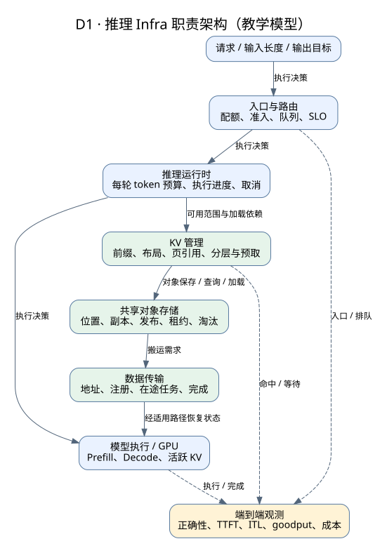
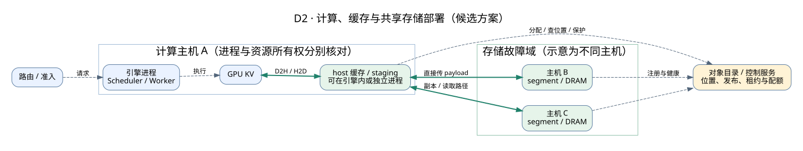
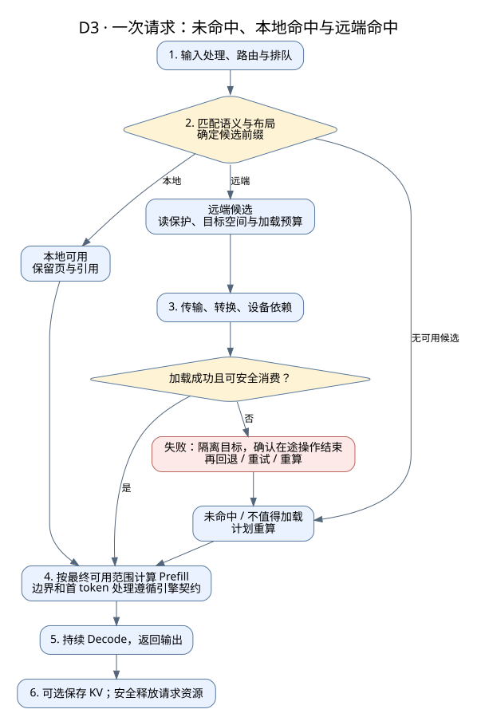
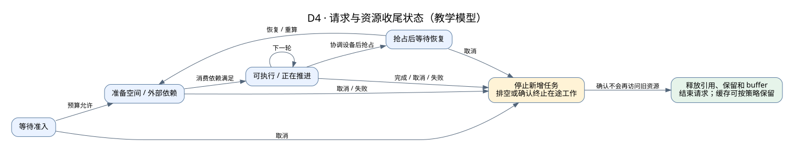
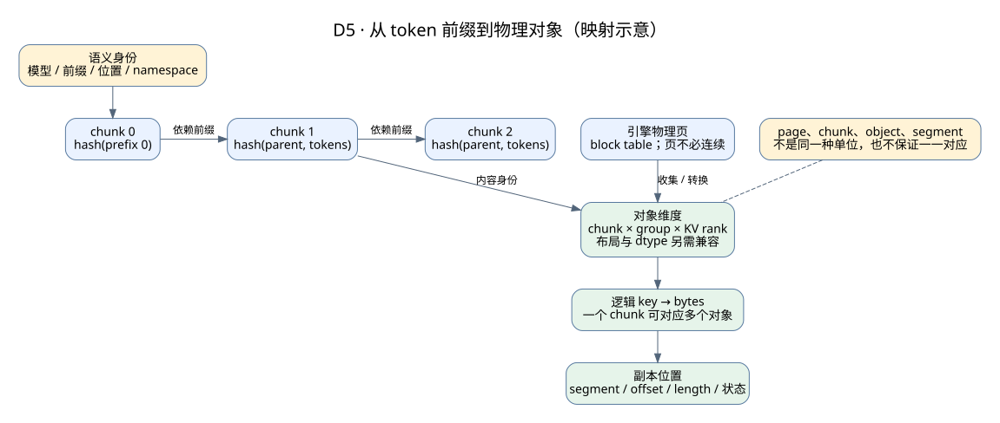
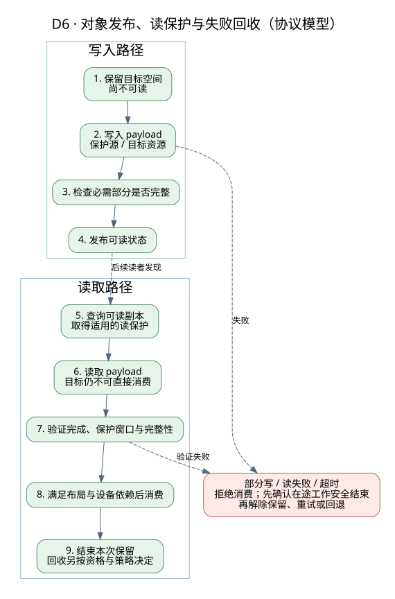
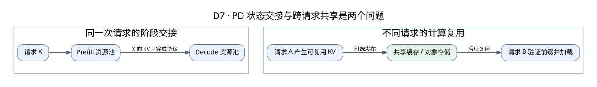
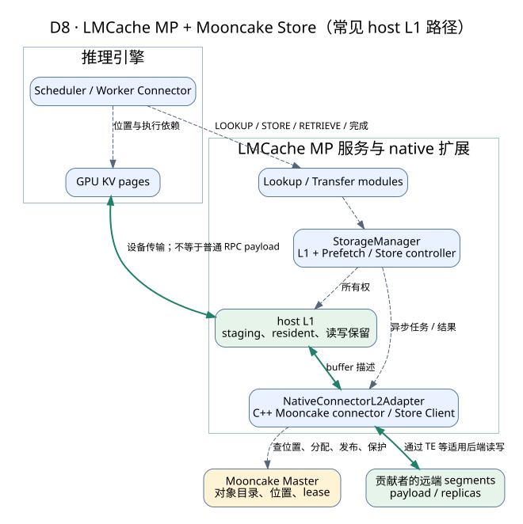
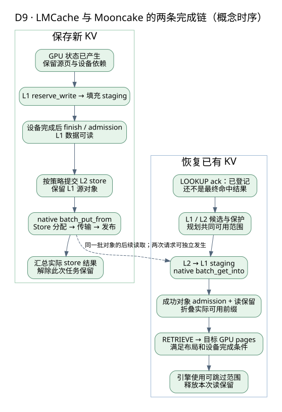

# 设计图册：从请求执行到共享 KV 存储

[总目录](../README.md) · [专家面试总纲](../08-career/expert-interview-guide.md) · [KV 存储详解](../04-storage/kv-cache-storage.md)

这份图册集中解释系统的职责、部署、运行、状态和数据关系。图片是已生成的 SVG，普通浏览器可以直接查看；每张图同时保留可编辑的 DOT 源文件。框架原有的 Mermaid 图放在文末的深读入口。

## 怎样读图

先问：图描述的是职责、物理部署、执行顺序，还是状态转换？职责分层不等于进程边界，逻辑箭头不等于逐行函数调用，更不保证两个实现可以直接互换。

| 图 | 用来回答什么问题 | 类型 |
|---|---|---|
| D1 | 各层决定什么、持有什么状态？ | 职责架构 |
| D2 | 进程和数据放在哪里，故障会影响谁？ | 部署与数据路径 |
| D3 | 冷请求、本地命中、远端命中怎么运行？ | 运行流程 |
| D4 | 取消和抢占为什么不能直接释放内存？ | 请求状态 |
| D5 | token、page、chunk、object、segment 怎么对应？ | 数据模型 |
| D6 | 对象什么时候可读，失败后如何收尾？ | 读写协议 |
| D7 | PD 分离和跨请求共享分别解决什么？ | 部署取舍 |
| D8 | LMCache 与 Mooncake 的控制、数据路径怎么衔接？ | 实现架构 |
| D9 | 本地完成、远端完成、GPU ready 有什么区别？ | 实现运行链 |

## D1 · 推理 Infra 职责架构



主箭头表示逻辑工作依赖，虚线表示观测。运行时决定算什么，缓存管理决定可复用什么，存储管理对象，传输搬运字节。一次优化可能同时改变多个层的成本，需要把结果落实到用户请求。

**专家追问**：把缓存控制独立成服务，哪些资源可以独立伸缩，哪些同步与故障依赖反而增加？谁最终决定可以跳过哪些 token？

[图源](diagrams/d01-system.dot) · [运行时正文](../02-runtime/README.md)

## D2 · 计算、缓存与共享存储部署



绿色实线表示 payload 路径，虚线表示控制或元数据。图示把副本放在两台主机上，**这是候选部署，不代表分配两个 segment 就自动实现跨主机容错**。目录服务的 HA、payload 的副本和读取者的临时 buffer 是三件事。

可以把 host 缓存和 Store segment 部署在计算主机上，也可以使用独立存储节点。选择时比较故障耦合、资源争抢、扩容粒度和网络拓扑。

**专家追问**：计算进程退出、整机退出、机架隔离、目录主节点切换时，哪些已有读取能继续，哪些新请求会阻塞，怎样限制重算风暴？

[图源](diagrams/d02-deployment.dot) · [存储详解](../04-storage/kv-cache-storage.md)

## D3 · 一次请求的三种缓存路径



这是一张教学运行图。命中远端只是候选信息，实际加载成功、数据布局正确、设备依赖满足之后，才能使用相应 KV。普通前缀复用失败时要重新确定连续可用范围，不能把零散成功的对象数加起来。

图中把阶段画成串行，是为了说明依赖；实现可以做预取和重叠。完整 prompt 命中也不意味着一定完全跳过首 token 相关计算，边界由引擎协议决定。

**专家追问**：加载超时但操作仍可能完成，目标 GPU block 应由谁隔离？重算、迟到回调和下一条请求如何避免写到同一位置？

[图源](diagrams/d03-request-flow.dot) · [缓存生命周期](../03-kv-cache/README.md)

## D4 · 请求状态与资源收尾



这里的状态名是教学抽象，不是某个引擎的 enum。用户取消请求，只表达“不再需要结果”；已经提交的 GPU/NIC 任务可能仍访问旧资源。请求结束和最后一块资源可回收，不一定发生在同一个时刻。

抢占前同样要协调设备和状态。等待恢复时保存什么、丢弃什么，取决于抢占策略；不能从这张图推断所有引擎都会把 KV 卸载到 CPU。

**专家追问**：如何设计回调幂等、任务代际、引用和排空协议？一次清理失败如何观测并防止无限泄漏？

[图源](diagrams/d04-request-state.dot) · [异步生命周期题](../08-career/interview-and-design.md)

## D5 · 从逻辑前缀到物理对象



前缀身份解决“是不是同一次计算状态”；group/rank/layout 解决“拿到的数据怎样解释”；segment 和 offset 解决“字节放在哪里”。多个逻辑维度可以组成一个 key，但具体编码方式和字段覆盖范围需要检查实现。

page、chunk、object 和 segment 并不保证一一对应。跨 rank 的完整性与不同 attention group 的窗口语义，需要在模型状态层判断，不能由普通对象存在性替代。

**专家追问**：一个 chunk 分成 4 个 rank 的对象，其中一个缺失，哪些 token 可以复用？滚动升级后 key 相同但布局改变，如何阻止旧状态被误读？

[图源](diagrams/d05-kv-layout.dot) · [容量与数据组织](../04-storage/kv-cache-storage.md)

## D6 · 对象发布、读取与失败



图描述共同协议目标。写入空间分配成功不等于对象已经完整；网络复制完成也不等于上层已发布。读取后还需要验证本次完成和保护条件，再交给消费者。

“结束本次读保护”不等于立即删掉对象。对象可能仍有其他读者，也可能继续作为缓存保留。租约是一种有时间边界的保护方式，引用计数和设备完成事件则解决不同层的问题。

**专家追问**：写者在分配后退出，如何保证不发布半成品，又不永久泄漏空间？主节点切换后怎样隔离旧写者和过期位置？

[图源](diagrams/d06-object-protocol.dot) · [Store 协议实现](../04-storage/implementations/mooncake/internals.md)

## D7 · PD 交接与共享缓存



上半部分是一次请求从 Prefill 阶段移交给 Decode 阶段；下半部分是后来的请求复用先前产生的状态。两种机制可以组合，但收益来源、保留时长和失败策略不同。

PD 不一定通过共享对象存储交接；共享缓存也不要求 PD 分离。专家选型应先明确工作负载和 SLO，再决定是否同时引入两种复杂度。

**专家追问**：Prefill 已成功而 Decode 接管失败时，怎样重试并限制重复计算？接管完成和长期缓存发布是否必须绑定？

[图源](diagrams/d07-pd-and-sharing.dot) · [Serving 与性能](../06-serving/README.md)

## D8 · 实现案例：LMCache MP + Mooncake



绿色路径是常见 host L1 配置中的数据移动；虚线是请求、资源管理或元数据交互。GPU↔host 的具体发起方与设备映射依赖集成模式，不能把所有 payload 画成普通 RPC 参数。

Store Master 不转发全部 KV 字节；native adapter 也不替推理引擎判断完整的模型语义。这里的“L1”指 LMCache 管理层级，和其他系统把 GPU 称为 L1 的命名不能混用。

**专家追问**：adapter 本地锁计数能保护到其他客户端吗？Store 的租约是否覆盖整个排队和读取窗口？谁承担 staging 的最坏内存预算？

[图源](diagrams/d08-lmcache-mooncake.dot) · [完整源码与契约讲解](../04-storage/implementations/lmcache/mooncake-walkthrough.md)

## D9 · 实现案例：保存与恢复的两条完成链



左右两条路径不是一次请求必须连续执行的步骤。写入可发生在请求 A，读取发生在请求 B；其中也可能有本地命中、部分失败和并发重叠。

左侧至少区分 GPU 产生数据、L1 发布、L2 保存三个事件；右侧至少区分 lookup ack、L1 可读、GPU 可消费三个事件。具体批量接口和单对象协议的对应关系见实现正文，不能把图当作逐行调用栈。

**专家追问**：批量写一半成功时上层如何计数与重试？第二个 chunk 加载失败而第三个成功时，如何重新确定安全复用范围？

[图源](diagrams/d09-lmcache-io.dot) · [联合链路详解](../04-storage/implementations/lmcache/mooncake-walkthrough.md)

## 原有框架图与图源维护

继续深入时看：[引擎架构图](../02-runtime/implementations/vllm/architecture.md)、[SGLang 运行图](../02-runtime/implementations/sglang/runtime.md)、[LMCache 状态与时序图](../03-kv-cache/implementations/lmcache/state-diagrams.rst)、[Mooncake 部署与读写图](../04-storage/implementations/mooncake/architecture.md)。

新图使用 Graphviz 生成；修改 DOT 后，在资料库根目录运行：

```bash
for diagram in 01-foundations/diagrams/*.dot; do
  dot -Tsvg "$diagram" -o "${diagram%.dot}.svg"
done
```

维护时同时检查图和相邻文字：箭头到底表示数据还是控制，状态转换需要哪个完成条件，故障路径是否遗漏，版本事实是否有源码依据。
