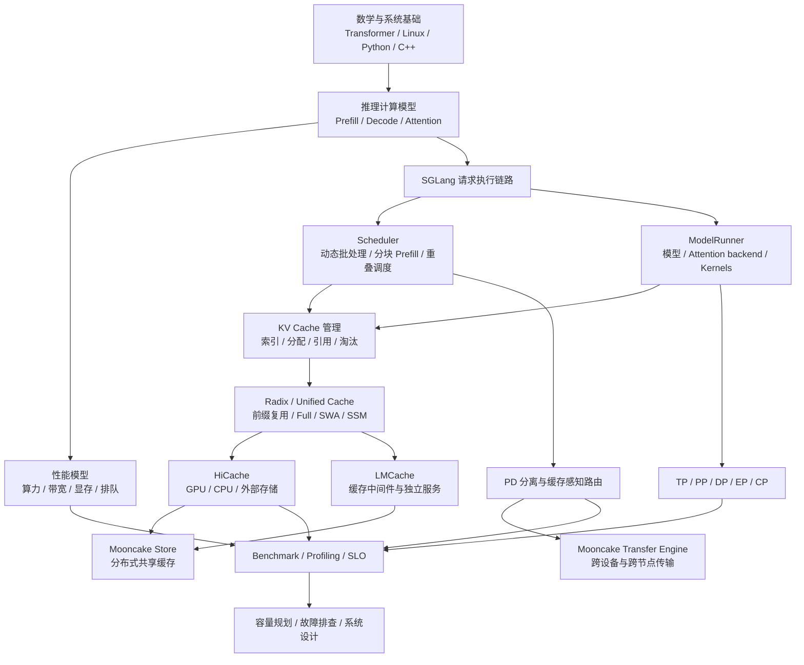

# 学习大纲与完整知识地图

[返回导航](overview.md) · [下一篇：28 天计划](../../../08-career/implementations/sglang/study-plan.md)

## 1. 优先级

- **P0：必须掌握。** 能解释原理、找到源码、完成基础计算。
- **P1：推理 Infra 核心竞争力。** 能通过实验分析取舍，并进行系统设计。
- **P2：按岗位深入。** Kernel、通信、多模态等专项能力。

| 模块 | 核心知识 | 达标要求 | 优先级 |
|---|---|---|---|
| 推理基础 | Transformer、因果 Attention、RoPE、Prefill、Decode、采样 | 解释一次生成的计算与内存访问 | P0 |
| 性能基础 | FLOPs、有效带宽、算术强度、Roofline、TTFT、ITL、TPOT、Goodput | 用数据定位瓶颈 | P0 |
| 服务架构 | HTTP、Tokenizer、IPC、Scheduler、ModelRunner、Detokenizer | 画请求链路并定位源码 | P0 |
| 请求调度 | Continuous batching、Chunked prefill、预算、抢占、回退、公平性 | 解释吞吐与延迟取舍 | P0 |
| GPU KV 管理 | 分页、地址映射、allocator、pool、共享、引用计数、淘汰 | 计算容量并解释生命周期 | P0 |
| 前缀复用 | Radix tree、最长前缀匹配、节点拆分、命名空间 | 手工模拟插入、匹配、淘汰 | P0 |
| GPU 执行优化 | FlashAttention、FlashInfer、CUDA Graph、融合、CPU/GPU overlap | 从 trace 识别优化机会 | P1 |
| 分布式推理 | TP、PP、Replica DP、Attention DP、EP、CP/DCP、NCCL、拓扑 | 解释通信、容量与扩展性 | P1 |
| 分层缓存 | HiCache、异步预取、写回、布局、跨 rank 一致性 | 解释缓存数据流及收益条件 | P0 |
| 共享缓存与传输 | Mooncake TE、Mooncake Store、LMCache、RDMA、NUMA | 选择方案并验证成本 | P0，重点 |
| PD 分离 | Bootstrap、KV 移交、资源预留、路由、独立扩缩容 | 解释收益与失败恢复 | P1 |
| 模型优化 | GQA、MLA、量化、MoE、投机解码、混合 Attention/SSM | 说清每种技术优化了什么 | P1 |
| 生产工程 | 限流、背压、超时、取消、可观测性、容量规划、灰度 | 设计可运维服务 | P1 |
| 扩展功能 | 多模态 EPD、LoRA、结构化输出、前端编程接口、Diffusion | 知道适用场景、边界与入口 | P2 |
| 底层开发 | CUDA/Triton、C++、内存布局、算子精度验证 | 编写与验证专用优化 | P2 |

## 2. 依赖关系图

图中的连接表示知识依赖或可选组件组合，不代表所有功能可以在当前版本同时启用。具体限制见 [框架对比与兼容性](../../../03-kv-cache/implementations/sglang/tiered-cache.md)。

## 3. 系统基础知识地图

### 3.1 CPU 与操作系统

- Linux 进程、线程、文件描述符、信号、进程间通信。
- Python GIL、异步 I/O、多进程的边界。
- socket、消息队列、共享内存、序列化开销。
- 虚拟内存、分页、内存映射、pinned memory。
- 锁、引用计数、所有权、超时和取消。
- NUMA：CPU、内存、GPU、NIC 的亲和性。

学习问题：请求取消后，哪些进程仍然可能持有它的资源？如何避免已经释放的 buffer 被异步操作继续访问？

### 3.2 GPU

- SM、warp、Tensor Core、寄存器、shared memory、HBM。
- 合并访存、数据复用、occupancy、寄存器压力。
- Kernel launch、CUDA stream、event、异步拷贝。
- GPU 内存分配、workspace、Graph capture。
- H2D/D2H、P2P、NVLink、PCIe。

学习问题：GPU 利用率高是否意味着算力打满？为什么一个更高 occupancy 的 kernel 不一定更快？

### 3.3 网络与分布式

- 延迟、吞吐、拥塞、小消息与大消息。
- TCP、RDMA、GPUDirect RDMA、注册内存。
- AllReduce、AllGather、ReduceScatter、All-to-All。
- 元数据控制平面与大对象数据平面。
- 租约、副本、幂等、超时、失效检测。

学习问题：传输接口返回成功是“已提交”还是“目标可读”？不同 rank 如何对下一次 collective 达成相同执行顺序？

## 4. 按岗位选择深度

| 方向 | 必修主线 | 额外重点 | 最有说服力的成果 |
|---|---|---|---|
| Serving runtime | 请求链路、调度、KV、性能 | 取消、抢占、公平性、SLO | 对混合负载调度退化的可复现分析 |
| KV / 缓存系统 | KV、HiCache、Mooncake、LMCache | 键空间、布局、生命周期、共享 | 冷热分层命中对比和跨实例复用实验 |
| 分布式推理 | 并行、MoE、PD | 通信拓扑、NCCL、RDMA、跨 rank 状态 | 多卡瓶颈与传输成本分析 |
| GPU Kernel | Attention、Roofline、layout | CUDA/Triton、融合、精度与硬件计数器 | 算子基准加端到端收益与精度验证 |
| 平台与生产 | SLO、容量、路由、监控 | 调度平台、灰度、容灾、多租户 | 有容量模型和失败路径的服务设计 |

## 5. 必须区分的概念

1. KV 物理内存管理与前缀索引。
2. 模型数学结构与 Attention backend 实现。
3. GPU 显存占用与实际有用缓存容量。
4. Prefix hit、数据加载成功与真正省掉计算。
5. 请求结束与缓存物理内存释放。
6. 传输提交与传输完成。
7. PD 传输与跨请求缓存共享。
8. 服务副本 DP 与模型内部 Attention DP。
9. 缓存容量扩展与单个超长上下文的执行能力。
10. 单 kernel 加速与端到端 Goodput 改善。

## 6. 扩展方向的边界

- **多模态 EPD**：编码器、Prefill 和 Decode 的资源需求不同；图像等输入会影响缓存身份和状态。
- **LoRA**：适配器会影响模型计算；不能跨不同适配器错误复用 KV。
- **结构化输出**：语法约束影响采样与 CPU 开销，可能改变重叠调度的依赖。
- **前端编程接口**：理解结构化多次调用如何产生前缀共享机会，不必在首月通读所有前端代码。
- **Diffusion**：生成流程和自回归 LLM 不同，应作为单独专题，不能照搬逐 token Decode 模型。
- **训练与 RL rollout**：本手册聚焦 serving，权重更新、rollout 调度等放在后续阶段。

## 7. 自测

不查资料回答：

- 一个请求的 KV 谁分配、谁写入、谁引用、谁淘汰？
- 给定模型与长度，能否估算显存和跨节点传输量？
- 缓存命中率提高而 TTFT 变差，可能经过哪些路径？
- 为什么共享缓存要求兼容性和租户隔离？
- 如何证明一个优化改善了实际服务，而不是仅改善微基准？
