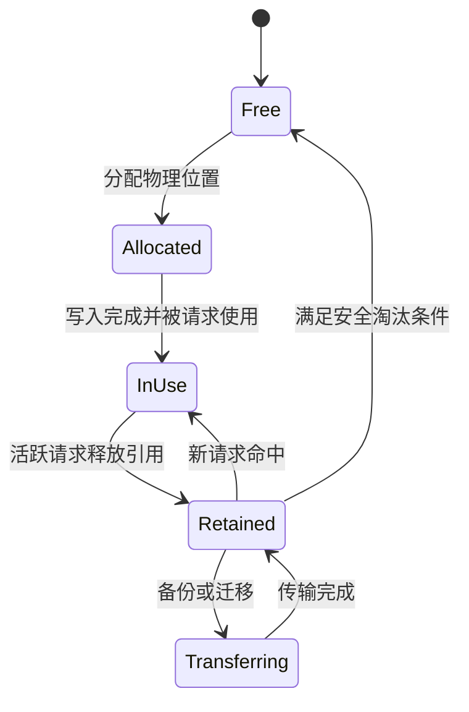

# KV Cache：原理、容量、分页、前缀复用与正确性

[返回导航](../../../02-runtime/implementations/sglang/overview.md) · [分层缓存与框架专题](tiered-cache.md)

## 1. KV Cache 保存什么

在标准因果自回归模型中，KV Cache 保存历史 token 在各层产生的 Key 和 Value。新增后续 token 不会改变历史位置已经计算的 K/V，因此可以复用。

新 token 的 Query 读取历史 K/V；历史 Query 通常不再用于未来步骤，因此通常无需缓存。

KV Cache 避免历史 token 在各层的重复前向计算，但新 token 仍需执行模型层和对历史 KV 的 Attention。序列增长后，KV 读取成本仍会增加。

## 2. 容量公式

对各层形状一致的标准 Full Attention：

$$
M_{\text{KV}}
=2\times L\times H_{\text{KV}}\times D_{\text{head}}
\times b\times\sum_i S_i
$$

| 符号 | 含义 |
|---|---|
| 2 | K 与 V |
| \(L\) | 层数 |
| \(H_{\text{KV}}\) | KV head 数，不是默认用 Query head 数 |
| \(D_{\text{head}}\) | Head dimension |
| \(b\) | 每元素字节数 |
| \(S_i\) | 请求 \(i\) 当前缓存长度 |

若不同请求共享物理前缀，不能重复计算该前缀的物理占用；上式按请求长度求和对应无共享或逻辑用量估计。

### 2.1 示例：GQA、BF16、8K 上下文

假设：

- 32 层。
- 8 个 KV heads。
- Head dimension 128。
- BF16，每元素 2 bytes。

$$
M_{\text{每 token}}
=2\times32\times8\times128\times2
=131072\text{ bytes}
=128\text{ KiB}
$$

因此：

- 8192 token 单请求约 1 GiB。
- 32 个不共享前缀的同长度请求约 32 GiB。
- 若改成 32 个 KV heads，每 token 512 KiB，8K 单请求约 4 GiB。

计算器示例：

```python
def kv_bytes_per_token(layers, kv_heads, head_dim, element_bytes):
    return 2 * layers * kv_heads * head_dim * element_bytes

per_token = kv_bytes_per_token(32, 8, 128, 2)
per_request = per_token * 8192
print({"bytes_per_token": per_token, "gib_per_request": per_request / 2**30})
```

### 2.2 模型权重与其他开销

Dense 8B 模型的 BF16 权重粗略为 16 GB，约 14.9 GiB。部署时还需预留：

- 激活与 workspace。
- CUDA Graph 的额外缓冲和内存池。
- 通信缓冲。
- 内存碎片与页面尾部浪费。
- 量化 scale、索引和元数据。
- 投机解码、混合状态、多模态或 LoRA 的额外资源。

不能用“GPU 显存减权重”作为完全可用的 KV 容量。

### 2.3 并发上限近似

无共享、长度近似一致时：

$$
C_{\text{capacity}}\approx
\left\lfloor
\frac{M_{\text{可用 KV}}}{M_{\text{每 token}}\times S_{\text{预算}}}
\right\rfloor
$$

这是容量上限近似，不是满足 SLO 的吞吐容量。\(S_{\text{预算}}\) 应考虑输入和输出增长；共享、碎片、调度及其他状态会改变结果。

### 2.4 并行切分

$$
M_{\text{每 rank KV}}
=2\times L_{\text{本 rank}}\times H_{\text{本 rank KV}}
\times D_{\text{head}}\times b\times S
$$

只有实际均匀切分时才可直接除以 TP size。KV 复制、PP、CP/DCP、MLA 等会改变每 rank 的状态分布。

## 3. 地址映射与物理分页

```text
请求 ID
  ↓
请求中 token 的逻辑位置
  ↓
KV slot / page 索引
  ↓
该层 K/V tensor 中的物理位置
```

| 组件 | 职责 |
|---|---|
| 批次分配策略 | 根据 batch 的增长决定需要哪些新位置 |
| Allocator | 管理空闲 slot/page，分配与回收索引 |
| KV pool | 定义实际张量和物理布局 |
| Prefix cache | 根据 token 前缀决定共享、保留与淘汰 |
| Attention backend | 按索引读取 KV 并执行计算 |

当前分层说明：[mem_cache README](https://github.com/sgl-project/sglang/blob/30dc2f94303e339431cbd51489b2d1719678b0c1/python/sglang/srt/mem_cache/README.md)。

分页让逻辑连续的序列可以对应非连续物理页，减少动态增长时的连续大块分配问题，也便于共享。它不能消除所有浪费，例如最后一页可能未填满，元数据也有成本。

页面大小的取舍：

- 小页：匹配粒度细，尾部浪费少，但索引和小 I/O 更多。
- 大页：元数据少，批量传输友好，但复用边界粗。
- 引擎 page 与外部缓存 chunk 的概念及大小不一定相同，需要 connector 正确处理对齐。

## 4. PagedAttention 与 RadixAttention

- PagedAttention 关注分页管理和按页访问 KV。
- RadixAttention 关注通过前缀树索引和复用已有 KV。

一个解决物理内存组织，一个解决逻辑复用索引，可以结合使用。

## 5. Radix tree 示例

```text
请求 1：A B C D E
请求 2：A B C D F
请求 3：A B G

root
  └── [A B]
        ├── [C D]
        │     ├── [E]
        │     └── [F]
        └── [G]
```

树节点通常保存物理 KV 的索引与元数据，不是每个节点都复制一份完整的请求 KV。

### 5.1 查找

`match_prefix` 沿 token 路径查找可复用的最长前缀，同时考虑页面边界与状态有效性。

### 5.2 插入

`insert` 将新的 token span 与 KV 索引纳入树，复用已有公共路径，并处理重复物理位置。

### 5.3 拆分

如果匹配或分叉发生在压缩节点内部，需要拆出新的公共边界。例如原节点 `[A B C D]` 遇到请求 `[A B G]`，应拆为 `[A B]` 与后续分支。

### 5.4 淘汰

`evict` 回收允许淘汰的物理缓存并维护树结构。保留共享父路径、保护活跃引用，以及多组件状态的一致性，是实现难点。

源码入口：

- [RadixCache：基础算法参考](https://github.com/sgl-project/sglang/blob/30dc2f94303e339431cbd51489b2d1719678b0c1/python/sglang/srt/mem_cache/radix_cache.py)
- [UnifiedRadixCache：当前主要路径](https://github.com/sgl-project/sglang/blob/30dc2f94303e339431cbd51489b2d1719678b0c1/python/sglang/srt/mem_cache/unified_radix_cache.py)
- [Unified 组件说明](https://github.com/sgl-project/sglang/blob/30dc2f94303e339431cbd51489b2d1719678b0c1/python/sglang/srt/mem_cache/unified_cache/components/README.md)

## 6. 生命周期与引用保护

下面是教学状态图，不是源码中的枚举名称：



真实实现可同时存在多个副本和多个引用，不能仅凭单个状态判断是否可释放。

关键不变量：

1. 活跃计算使用的物理位置不能被覆盖。
2. 传输读取的源 buffer 在操作完成前不能提前复用。
3. 目标数据完整就绪前不能被当作有效缓存消费。
4. 请求取消后仍需处理异步操作的引用和完成状态。
5. 树中的有效索引必须对应有效的物理资源。

请求完成时，通常释放请求引用和私有资源；可复用 KV 可继续留在树中，等后续策略淘汰。

## 7. 缓存兼容性与 key

正确复用至少考虑：

- 模型权重与版本。
- 实际 token IDs、前文和位置。
- RoPE、Attention mask 等计算语义。
- LoRA 或其他改变前向结果的适配器。
- 多模态输入所产生的状态。
- KV dtype、量化参数、存储布局。
- 并行切分和兼容的重组方式。
- 租户、命名空间与 cache salt。

通常采样温度不改变输入 Prefill 的 KV，但采样结果会改变后续序列。

分布式缓存常用带历史信息的链式 hash，概念上：

$$
h_i=H(\text{namespace},h_{i-1},\text{当前 token 块})
$$

只 hash 当前文本块不够：相同文本放在不同前文后，KV 可能不同。

命名空间隔离也不等于访问控制。生产系统还需要服务认证、权限、配额和网络隔离。

### 7.1 当前可选统一 L3 key scheme

当前源码有 `--hicache-storage-key-scheme unified` 对应的统一方案，用层范围、head 范围等数据坐标描述对象，而非仅按写入 rank 命名。

这要求整个共享域约定：

- head group。
- layer partition。
- page size。
- 模型标识与逻辑 dtype。
- 对象布局及其他兼容条件。

不能认为任意 TP/PP 配置天然能互换 KV。默认按本地 shard 推导的配置也不等于跨拓扑共享已完成。

[统一 key scheme](https://github.com/sgl-project/sglang/blob/30dc2f94303e339431cbd51489b2d1719678b0c1/python/sglang/srt/mem_cache/hicache_key_scheme.py)

## 8. GQA、MLA、SWA 与 SSM

| 类型 | 缓存特征 | 容量与正确性注意事项 |
|---|---|---|
| MHA | 多组 K/V heads | 根据实际 KV heads 计算 |
| GQA | 多个 Query heads 共享较少 KV heads | 不要用 Query head 数估算 KV |
| MQA | 更少 KV heads | 仍需考虑实现中的复制 |
| MLA | 压缩 latent 与位置相关状态等 | 按实际 pool 的 shape 和 dtype 计算 |
| SWA | 相应层只需窗口范围内历史 | 混合模型中的 Full 层仍可能需要完整历史 |
| Mamba/SSM | 递归状态、checkpoint、分支 COW | 不等同于普通逐 token KV |
| 混合模型 | 多类状态共同决定可恢复前缀 | 不能只看 Full KV 命中长度 |

MLA 的具体缓存取决于模型与 backend；不能普遍把它写成某个固定压缩比例。

Mamba/SSM 的状态通常不以 Full Attention 同样的方式随序列增长，但前缀分支、检查点和并发会增加所需状态数量。

## 9. Unified Cache 的多组件语义

当前实现把 Full、SWA、Mamba 等抽象为组件：

- 共享逻辑前缀树。
- 各组件保存自己的物理状态和锁引用。
- 匹配必须满足相关组件有效性。
- 物理恢复可能涉及 COW。
- 淘汰可能触发跨组件级联，以保持可恢复状态一致。

Full 组件当前通过可淘汰叶集合管理候选，辅助组件有独立 LRU。不要把“Unified”理解成所有状态只有一个内存池或一种淘汰算法。

## 10. 量化、压缩、淘汰与分层

| 技术 | 改变什么 | 必须验证 |
|---|---|---|
| KV 量化 | 每个值的精度与字节数 | 质量、scale、转换与 kernel 开销 |
| KV 压缩 | 存储/传输表示 | 压缩率、编解码、质量 |
| 缓存淘汰 | 保留哪些缓存 | 未来复用率、重算、活跃状态正确性 |
| 分层迁移 | 缓存位于何种介质 | 容量、带宽、加载与生命周期 |

淘汰未使用的前缀主要影响未来重算；删除活跃 Attention 必需的内容则可能改变语义，或要求专门恢复。两者必须区分。

## 11. 完整命中与非前缀复用

完整 Prompt 命中不一定意味着零计算：

- 系统通常缓存 KV，不一定保存末位置 hidden state 或 logits。
- 可能需要重新处理最后一个 token 来获得输出分布。
- 页面或 chunk 对齐可能导致尾部没有复用。
- 混合模型可能缺少对应 checkpoint。

RAG 文档块出现在新的前文之后时，其 KV 通常会变化。直接拼接独立计算的文档 KV 不能保证标准 Attention 的原始语义。相关 CacheBlend 方法见 [06](tiered-cache.md)。

## 12. 正确性检查清单

- 相同输入、模型、配置下，与无复用路径比较。
- 检查首次匹配、节点内部拆分、部分页命中。
- 检查并发共享、重复插入、淘汰后重命中。
- 检查取消、超时、异步传输完成后清理。
- 检查 LoRA、dtype、layout、位置、版本与租户隔离。
- 检查多 rank 成功恢复长度的一致性。
- 检查混合状态缺失时是否拒绝错误命中。
- 对数值差异使用合适的 logprob/任务质量验证，不把所有非 bitwise 一致都判为错误。

## 13. 练习

1. 将示例的 BF16 改为 1 byte KV，计算理论数据体积；列出未计入的 scale 和转换成本。
2. 32 个请求共享 4096 token 前缀、各有 4096 token 私有后缀，计算理想物理 KV，比较无共享情况。
3. 对 page size 64，解释 130 token 前缀在只复用完整页的情况下可能留下多少尾部。
4. 构造“文本块相同但前文不同”的反例，解释为什么不能仅按块文本 hash。
5. 说明一次异步回写期间请求被取消时，源与目标分别需要什么保护。
