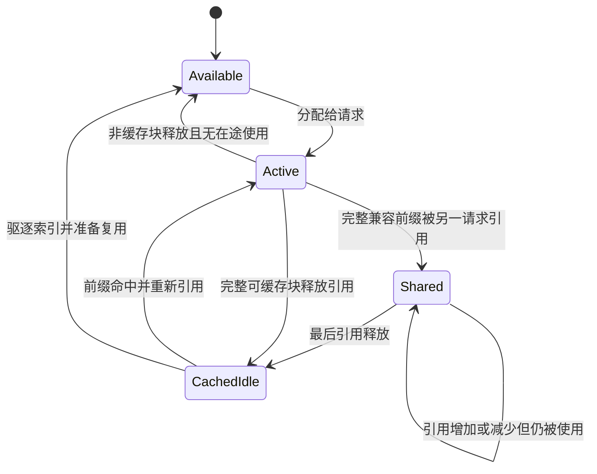
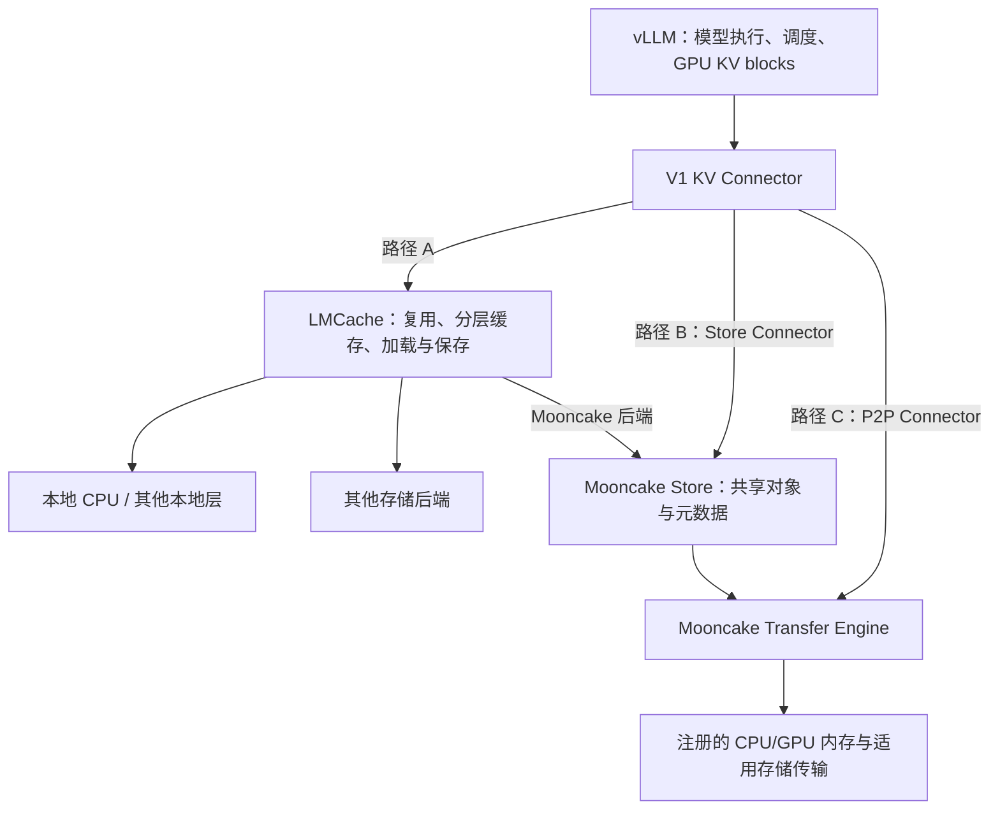
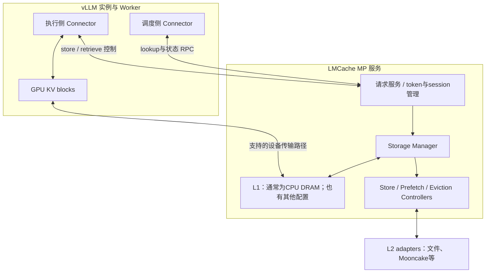
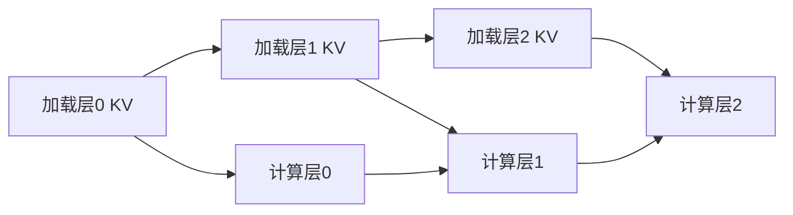
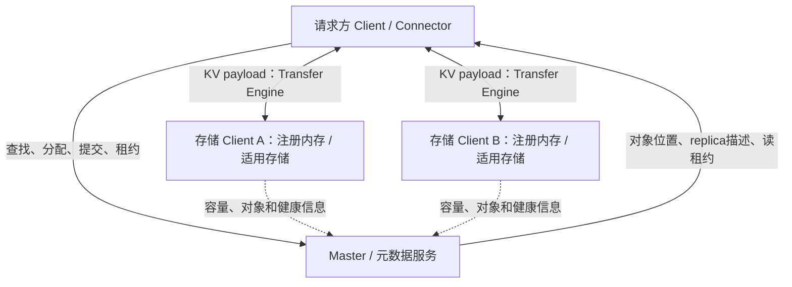
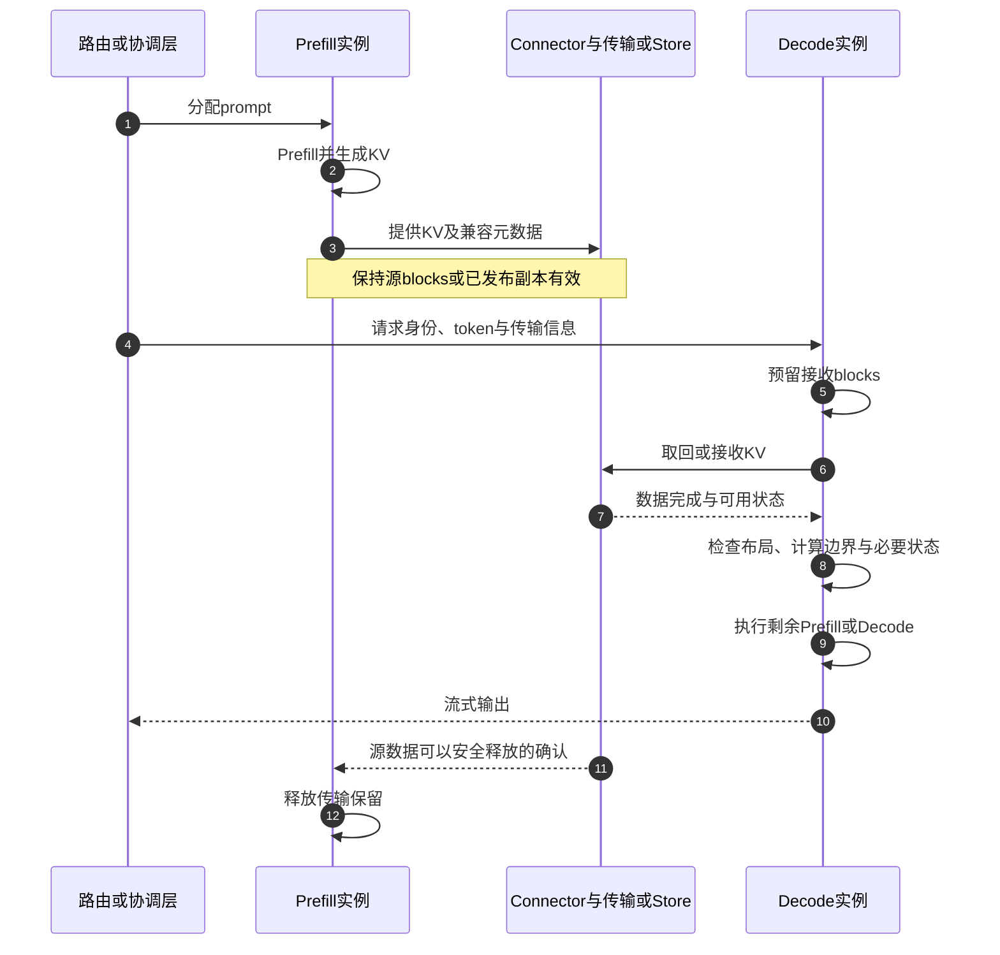

# KV Cache 专题：vLLM、LMCache 与 Mooncake

[返回导航](../../../02-runtime/implementations/vllm/overview.md) · [设计图](../../../02-runtime/implementations/vllm/architecture.md) · [实验](../../../07-practice/implementations/vllm/experiments.md) · [资料索引](../../../08-career/implementations/vllm/references.md)

本章围绕五个问题展开：**缓存了什么、何时可以复用、放在哪里、怎样传输、什么时候才能回收。**

## 1. 首先区分四种“缓存”

| 名称 | 缓存内容 | 复用范围 | 主要收益 |
| --- | --- | --- | --- |
| 请求内 KV Cache | 历史 token 在每层的 K/V | 同一请求后续 Decode | 避免重复计算历史位置的状态 |
| Prefix Cache | 已计算前缀的 KV | 兼容请求之间 | 避免重复 Prefill |
| 分层/分布式 KV 缓存 | GPU 外保存的 KV 对象/chunks | 会话、实例、节点之间 | 扩大可复用容量与共享范围 |
| 响应缓存 | 完整答案或应用结果 | 相同或应用认可的请求 | 可能完全跳过模型执行 |

本手册主要讨论前三种。KV 复用后仍需计算未命中的输入、采样并生成输出，不能把它当成完整答案复用。

## 2. KV Cache 的数学含义

在某层，以该层输入隐状态 X 为例：

```text
Q = X Wq
K = X Wk
V = X Wv
Attention(Q,K,V) = softmax(Q K^T / sqrt(d) + causal_mask) V
```

实际模型还涉及 RoPE、GQA 的 head 映射、归一化和不同 backend 的数据布局。

生成新 token 时，其 query 需要访问历史位置的 K/V。缓存这些 K/V 后，不必为每个 Decode step 重做整个历史序列的 forward；但仍需读取所需历史 KV 并执行新 token 的 Attention、FFN 等计算。

因此 KV Cache **降低重复计算，但增加常驻状态和显存访问**。长上下文时，即使不重算历史 K/V，读取它们的成本仍可能很高。

## 3. 如何算容量

对各层配置相同、K/V head dimension 相同的普通全注意力 Transformer：

```text
每 token KV 字节数 = 2 × L × Hkv × Dhead × b
总逻辑 KV 字节数 = 每 token KV 字节数 × ΣTi
```

L 是层数，Hkv 是 KV head 数，Dhead 是 head dimension，b 是每元素字节数，Ti 是第 i 个序列缓存的 token 数。

### 计算例子

32 层、8 KV heads、head dimension=128、BF16：

```text
每 token = 2 × 32 × 8 × 128 × 2 = 131072 bytes = 128 KiB
8192 tokens = 1 GiB
32 条这样的独立序列 = 32 GiB 的逻辑 KV
```

如果 KV head 数由 8 变成 32，其他配置相同，则容量变成 4 倍。这是 GQA/MQA 影响缓存成本的直观原因。

### 从逻辑容量到物理容量

还必须考虑：

- block 分配向上取整；共享前缀只保存一份时的节省。
- 模型权重、激活、workspace、CUDA Graph、通信和传输缓冲。
- TP/PP 后每 rank 的层/head 布局；KV heads 很少时可能复制，不能一律除以 TP。
- KV 量化的 scale、对齐与元数据，不仅是 dtype 字节数。
- Full/SWA 混合、跨层 KV 共享、MLA、Mamba 状态等特殊模型。

对异构层，应按每层真实缓存状态求和。MLA 的 latent cache 不能直接代入普通 Hkv 公式；SWA 可只需窗口内状态，但实际回收与 prefix 复用规则仍由实现决定。依据：V5。

## 4. vLLM 的分页管理

vLLM 用固定粒度的 block 管理 KV，让逻辑连续序列映射到物理非连续内存。

核心对象可以从概念上分成：

- **请求 block table**：逻辑块到物理块的映射。
- **block pool**：统一管理可用物理块。
- **引用计数**：多少活跃使用者仍依赖此块。
- **hash 索引**：哪些完整块代表可复用前缀。
- **free/eviction 结构**：哪些块可重新分配，哪些缓存内容被淘汰。

`ref_cnt=0` 不必意味着内容立即被清零。一个没有请求引用的完整块可以保留 hash 和内容，供后续前缀命中；当容量需要时才移除其映射并复用内存。缓存有效性、活跃引用和物理可分配性是不同属性。

### D10：本地 block 的概念生命周期



图只画基本本地情况。若有异步保存、RDMA 读取或 GPU 访问，必须先等待相应操作完成；外部 connector 可以要求延迟回收。

PagedAttention 的价值主要在于按需分配、降低碎片和安全共享，不是对 KV 做压缩。与 FlashAttention 的 IO 优化可以组合。

## 5. Prefix Cache 的正确性条件

在因果 Transformer 中，某位置的深层 K/V 一般依赖前面的完整 token 上下文。**同一段文字放到不同前文后面，其 KV 通常不同。**

普通前缀缓存通常用链式 hash：

```text
H_i = Hash(H_(i-1), 当前块 token IDs, 影响缓存身份的附加信息)
```

链式结构将前序上下文编码进 key；只 hash 当前文档文本是不够的。完整块通常是基本缓存单位，尾块是否能复用取决于实现。

跨实例系统还需要正确的命名空间。以下是设计上需要区分的因素，不代表所有实现把它们逐项序列化到同一个 key：

| 因素 | 为什么需要区分 |
| --- | --- |
| 模型权重及 revision | 相同 token 在不同权重下有不同 KV |
| LoRA/adapter 身份与版本 | adapter 可改变计算结果 |
| token IDs 与前序 hash | 文本相似不等于 token 前缀相同 |
| 位置、RoPE 配置及相关语义 | 位置编码变化可导致 KV 不兼容 |
| 多模态输入身份 | 相同占位 token 可能对应不同图片或音频 |
| KV dtype、布局、层/head/rank 描述 | 消费者必须能正确解释字节 |
| 租户/缓存 salt/访问权限 | 防止不允许的跨租户复用和信息泄露 |

tokenizer 与 chat template 应固定，它们决定实际 token 序列。temperature/top-p 通常不改变已给定 token 前缀的 forward，因此不必机械地将所有采样参数放入 KV key；应区分计算相关配置与输出选择策略。

哈希冲突处理、强 hash、命名空间和访问控制都重要，不能把普通 hash 当作权限系统。依据：V4。

## 6. 三个框架分别负责什么

### D11：可组合的框架关系



这些路径是不同组合，不要求全部同时启用。

| 组件 | 核心职责 | 使用它不能自动获得什么 |
| --- | --- | --- |
| vLLM 本地 KV/APC | 执行时 GPU block 管理、兼容前缀复用 | 默认不能把所有实例的 HBM 变成共享缓存 |
| LMCache | 以 token/chunk 为中心组织复用、存储和加载，接入多个后端 | 不替代引擎的模型 forward 和 GPU block manager |
| Mooncake Transfer Engine | 注册内存和高性能异步数据搬运 | 单独没有 token 前缀匹配、完整对象缓存策略 |
| Mooncake Store | 分布式对象位置、容量、复制、读写和生命周期 | 不自动知道所有模型语义，也不等于全局请求调度器 |
| Mooncake 论文系统 | 围绕 KV 的完整服务架构、调度和过载控制 | 安装一个开源组件不等于复现论文所有策略 |

依据：V6～V8、L1～L6、M1～M6、P3。

## 7. 为什么需要 GPU 之外的缓存

HBM 很快但容量昂贵。当会话暂时不活跃、长文档之后还会被访问，或者同一前缀会流向其他实例时，把可复用 KV 留在 CPU/SSD/远端池中，可能比下次重新 Prefill 更划算。

需要同时考虑三种成本：

1. **保存成本**：GPU→CPU、打包、写入、占用带宽和容量。
2. **查找与取回成本**：hash/元数据、排队、网络、H2D、布局转换和同步。
3. **未来节省**：被复用的概率、节省的 Prefill 时间、释放出的 GPU 计算能力。

外部缓存容量增大不代表任意长度的活跃请求都能直接执行。普通 Attention 执行仍需它所依赖的工作集在支持的位置可访问；是否支持逐层 offload、流式 KV 或特殊 attention 是另一个问题。

“缓存 offload”也不一定表示把正在 Decode 的 KV 不停逐出 GPU。常见价值是保存可复用副本，在请求结束并释放 GPU 引用后，未来再恢复。

## 8. LMCache：从引擎语义到分层存储

### 8.1 基本链路

1. 从 token 与模型上下文确定可复用 chunk 身份。
2. 查询引擎本地尚未覆盖的范围。
3. 找到兼容前缀后，准备目标 GPU blocks。
4. 从可用层取回数据并加载到引擎布局。
5. 确认数据可用，再跳过对应 Prefill 计算。
6. 对新计算、值得缓存的 chunks 执行保存。

本地 APC 与 LMCache 可能共同覆盖一个 prompt，但不能把二者命中率直接相加：外部缓存查询通常针对本地未覆盖部分，分母可能不同。

### 8.2 进程内模式与 MP 模式

历史进程内集成把较多缓存管理逻辑放在引擎进程中。官方部分页面已将其标记 deprecated，并引导使用 MP；MP 用独立服务管理缓存，可服务同节点多个引擎实例。

MP 的收益包括进程隔离、共享缓存和独立资源配置，但仍有 RPC、跨进程协调和数据搬运开销。版本兼容要按所选 release 核对；不能把旧 `LMCacheConnectorV1` 配置与新的 `LMCacheMPConnector`/server 参数任意拼接。

### D12：LMCache MP 架构



控制消息传输与大块 KV 搬运不是一回事。不能仅因为使用 ZMQ/gRPC，就推断 GPU KV 必须作为普通 RPC 字节流复制。实际 GPU 数据路径可涉及 CUDA IPC、专用传输机制和 pinned memory，依版本/模式而定。

MP 的 L1 通常是 CPU DRAM，官方也介绍 GDS 等变体；L2 的“外部/次级”名称不保证重启后持久。DRAM 池、临时 NVMe slab、持久文件系统具有不同恢复能力。

### 8.3 chunk 与 vLLM block

vLLM block 侧重设备执行分配；LMCache chunk 侧重缓存索引、传输和存储。二者不必一比一。

用前面的 128 KiB/token 模型举例，忽略分片与开销：

```text
16-token block 的全层 KV 数据量约为 2 MiB
256-token chunk 的全层 KV 数据量约为 32 MiB
一个 chunk 可覆盖 16 个这种 block
```

这只是粒度例子，不是默认配置，也不表示全层 KV 必然连续放在一块物理内存中。混合模型可能有多个 KV groups，实际 chunk 需要满足几何对齐；MP 提供相应协商机制。依据：L7。

- chunk 太小：元数据、hash、RPC、锁和小 IO 比例增加。
- chunk 太大：短公共前缀难命中，搬运无用数据，首批可用时间可能更长。
- 最佳粒度依赖模型、请求分布、存储介质、并发和对齐条件。

### 8.4 layerwise 与异步重叠

不必总等所有层 KV 都加载完才开始任何计算。适用实现可以先加载第 0 层、执行该层，并同时加载后续层；保存也可按层流水。

### D13：逐层加载与计算的依赖示意



同层计算必须等待本层所需 KV；不同层的加载和计算才可能重叠。收益受共享 HBM/PCIe 带宽、计算时间和同步粒度限制，并非“异步就免费”。

历史 layerwise 路径与 CUDA Graph 的兼容性有限制，例如某些 connector 要求 piecewise capture。MP 与历史实现应分别核对，不能把一套实现的 hook 行为当作另一套的保证。依据：L9、V13。

### 8.5 CacheBlend：为什么单独讨论

假设原来计算过文档 B；新请求变成 `[系统提示, 文档 A, 文档 B, 问题]`。B 前面的上下文发生了变化，它的深层 KV 通常不再与单独计算 B 时一致；仅修正 RoPE 位置也不能恢复缺失的上下文交互。

CacheBlend 尝试复用非前缀片段，同时对部分 token 的 KV 做选择性重计算，并可重叠取回与计算。这属于带质量权衡的优化：

- 需要处理 token 边界、位置与跨片段注意力。
- 不应宣称与完整 Prefill 在所有输入上数值完全相等。
- 应对目标任务测量质量、TTFT、重算比例和失败案例。
- 同一字符串单独 tokenize 与拼接后 tokenize 可能不同，必须确认实际 token 输入。

普通精确前缀复用与 CacheBlend 应分别做实验。依据：L8、P4。

## 9. Mooncake Transfer Engine

Transfer Engine 是嵌入数据生产者/消费者进程的数据移动基础设施。核心概念：

| 概念 | 作用 |
| --- | --- |
| Segment | 命名可访问的地址空间；不代表整个地址空间都已注册可传输 |
| Buffer 注册 | 声明可传输的内存区域、地址与相关访问/设备信息 |
| BatchTransfer | 批量提交多个地址范围的异步 read/write |
| Transport | 实际搬运路径，如适用环境中的 RDMA、TCP、NVLink 等 |
| 元数据发现 | 获取远端 segment、buffer、endpoint 等连接信息 |

要重点理解：

- **RDMA**：减少远端 CPU 参与数据拷贝，不消除网络传输和拥塞。
- **GPUDirect RDMA**：适用配置下让 NIC 访问 GPU 内存，减少 CPU staging；依赖 GPU/NIC/驱动/拓扑支持。
- **零拷贝**：通常指减少中间副本，不等于没有设备读写、传输或注册成本。
- **多 NIC**：需要正确映射 GPU、NUMA 与 NIC；标称带宽不能直接相加当作应用吞吐。
- **异步完成**：提交成功不是数据已到达且可消费；源内存必须保持有效直到约定完成。

Transfer Engine 本身不负责理解“这个 token 前缀与某模型是否兼容”。这由引擎、connector 或上层缓存负责。依据：M1、M2。

## 10. Mooncake Store

Store 在传输基础上管理命名对象、存储位置、容量和生命周期。对 KV 场景，上层通常用 token/模型相关身份构造对象 key；不要误以为 Store 会自动解析所有模型语义。

### D14：元数据面与数据面



大块 KV payload 不应绕行 Master。Master 提供位置和管理信息，客户端按描述直接访问数据。Transfer Engine 用于发现连接的元数据服务与 Store 对象 Master 也是不同职责，部署时不能混为一个配置项。依据：M3、M4。

### 写入与发布

概念上需要“预留位置 → 写入数据 → 完成确认 → 发布可读状态”。只发布 key、数据尚未完整落到可读位置，会导致部分对象被读取。

Store 文档描述不可变对象及完整读语义；具体多副本策略和保证以版本为准。单对象成功不等于一个请求的所有层、rank 或多个 chunks 都已就绪，上层仍需检查完整集合。

### 读取与租约

Get 先获取对象位置和读保护，再执行数据读取。读取期间若对象被驱逐或其内存被重用，会出现读错数据的风险，因此需要 lease/pin 等机制。

lease 是有期限的使用权，不是永久锁。官方文档说明租约过期导致读取失败时应防止返回潜在损坏数据。超时时间要匹配对象大小、排队和网络状态，不能照搬固定常数。

### 复制、持久化与失败

- 多副本可提高可用性和分散热点，但增加保存带宽与容量；实际复制可能是 best effort。
- DRAM 存储节点宕机可能丢缓存；是否能恢复取决于剩余副本、元数据和持久介质。
- SSD/文件系统后端不自动保证任意崩溃情形下的完整恢复，仍需元数据与提交协议配合。
- KV 是可重算数据，但故障期间的重算可能压垮 Prefill，所以还需要 admission 和退避。

## 11. 集成路线怎么选

| 路线 | 适合重点 | 需要额外解决的事 |
| --- | --- | --- |
| vLLM 本地 APC | 同实例重复前缀、起步基线 | HBM 容量、路由导致的命中分散 |
| vLLM → LMCache → 本地/远端后端 | 分层复用、多后端策略、缓存专项能力 | 版本、chunk 对齐、缓存服务与拷贝开销 |
| vLLM → MooncakeStoreConnector | 直接共享 KV pool、跨实例 prefix 复用 | Store 部署、key 兼容、故障和资源配置 |
| vLLM P → MooncakeConnector → vLLM D | P2P 的 PD KV 交接 | P/D 路由、源数据保留、目的端就绪 |
| vLLM → LMCache → Mooncake Store | LMCache 复用管理加上共享分布式存储 | 两层控制与配置、定位额外开销 |

`MooncakeConnector` 的直接 P2P 传输与 `MooncakeStoreConnector` 的共享对象存储具有不同语义。官方也介绍组合 connector 的配置，但是否适用某个模型/版本，必须逐项验证。

LMCache 可以用 Mooncake 作为后端，因此“LMCache 和 Mooncake 谁替代谁”通常不是合适的问题。先确定需要的是复用管理、对象池还是点到点传输，再选择组合。

## 12. PD 分离中的 KV 交接

PD 将 Prefill 和 Decode 放到不同实例或资源组，便于分别规划并行与容量，并降低长 Prefill 对 Decode 尾延迟的干扰。

### D15：Prefill 到 Decode 的安全交接



P2P、push/pull、Store 中转的具体握手不同，最后两步也可能与 Decode 并行；图强调的是所有权而非固定顺序。首 token 由哪端返回、是否传递采样结果、哪些尾部 token 需重算，由 connector/服务实现决定。

除了 KV，还要对齐 prompt token IDs、位置、模型/adapter、层/head/rank、KV dtype/layout、已计算长度，以及实现要求的输出/采样状态。

P 和 D 的 TP 数不同，常常需要 reshard/重排或特定支持，不能直接把指针发过去。用同模型名字和相同 dtype 不足以证明字节兼容。

PD 不保证提升原始吞吐：增加了 KV 传输和协调成本。应比较在相同资源、工作负载和 TTFT/TPOT 目标下的 Goodput，并计入缓存与网络成本。依据：V7、P2、P3。

## 13. 取回缓存还是重新计算

定义：

```text
T_recompute：在当前负载下重算可复用前缀的增量时间
T_load：lookup + 排队 + 远端读取 + 网络 + H2D + 布局转换 + 同步
T_overlap：与其他必要工作实际重叠掉的部分
```

粗略判断：

```text
复用有时间收益的必要比较：
T_load - T_overlap < T_recompute
```

这不是全服务最优公式：缓存也可能释放 GPU 计算容量、改变排队和路由。做系统决策还应比较未命中后缀的计算、保存成本、命中概率、带宽竞争、SLO 和总资源成本。

例如要传输 1 GiB KV，400 Gbit/s 链路理想有效载荷上界为 50 GB/s：

```text
理想单链路传输下界 ≈ 1 GiB / 50 GB/s ≈ 21.5 ms
```

实际还会有协议、共享链路、内存、元数据和同步开销，可能远高于此；GPUDirect 可减少某些中间拷贝，但不会突破真实瓶颈带宽。

若节省的重算仅 5 ms，此规模搬运通常不划算；若节省 200 ms，可能有收益，仍需实测。分层预取/流水会改变关键路径，不能把每阶段耗时简单相加后声称等于最终 TTFT。

## 14. 缓存路由与调度

只选命中最多的节点，可能把热点节点压成队列瓶颈。可以用教学成本模型思考：

```text
候选节点代价 ≈ 预计排队 + 缓存取回 + 未命中部分计算 + 网络/输出开销
```

再加上容量、SLO、租户公平性与失败风险约束。实际调度器可能使用预测模型或启发式，不一定直接使用上述加法。

可优化的维度包括：

- 将重复前缀路由到有缓存且队列合理的实例。
- 在热点复制与存储成本之间取舍。
- 对未来重用概率极低的大对象减少写入，避免缓存污染。
- 根据节省的计算时间、对象字节数和重用概率选择缓存价值。
- 过载时限流/拒绝，避免无界排队和重算风暴。

Mooncake 论文中的 KV 中心化调度和过载策略值得学习，但不能宣称接入 Transfer Engine 后自动拥有这些策略。

## 15. 正确性与故障清单

| 场景 | 必须保证的语义 | 可采用的处理 |
| --- | --- | --- |
| lookup 后对象被驱逐 | 不能使用过期位置或未完成 KV | pin/lease；失败后撤销命中并重查/重算 |
| 异步保存尚未结束，请求完成 | 源内存不被提前复用 | 延迟 block 回收；保存完成后释放 |
| 接收端取消 | 在途 DMA 与目标内存生命周期一致 | 取消或等待完成，再回收目标缓冲 |
| P/D 一端宕机 | 不永久占用 blocks，也不读取已复用内存 | 完成通知、期限/租约、失败清理 |
| 多层或多 rank 只到一部分 | 不能将局部成功当作完整前缀可用 | 明确完成集合和计算依赖 |
| 模型/adapter 更新 | 旧 KV 不被错误复用 | 版本命名空间、失效或重建 |
| 跨租户共享 | 尊重权限与隔离策略 | namespace/salt/访问控制，避免敏感日志 |
| 慢网或 Store 不可用 | 不无期限阻塞全部推理 | 超时、限流、熔断、可承受的重算回退 |
| 重算恢复导致突发流量 | 不形成二次过载 | admission、退避、并发限制 |
| KV 量化或 CacheBlend | 不把质量下降隐藏在性能结果中 | 任务质量和数值对照 |

租约到期也不能让设备仍在访问的内存被不安全地复用：控制层必须与实际传输取消/完成、内存保护协议协作。

## 16. 专项需要观察的指标

| 维度 | 建议指标 |
| --- | --- |
| 业务 | TTFT/ITL/TPOT 分位数、Goodput、失败/拒绝率 |
| 复用 | 本地/外部命中 token、有效跳过 Prefill 的 token、命中深度 |
| 搬运 | 保存/取回字节、有效带宽、lookup/IO/H2D/重排时间 |
| 容量 | HBM/CPU/SSD 占用、pinned memory、在途缓冲和被保留 blocks |
| 生命周期 | 驱逐率、lease 超时、load 失败、重试、重算、未释放引用 |
| 质量 | logits/输出差异、任务评分；量化/Blend 独立报告 |
| 成本 | 满足 SLO 的成功请求成本、每百万输出 token 成本 |

高命中率可能仍然慢：取回比重算慢、对象粒度不合适、元数据排队、CPU/H2D 瓶颈、热点路由，都可能造成这种情况。

## 17. 推荐的源码追踪问题

| 项目 | 定位入口 | 要追踪的问题 |
| --- | --- | --- |
| vLLM | `vllm/v1/core/` | hash 命中如何转换成可复用 token 与 blocks？ |
| vLLM | `vllm/distributed/kv_transfer/kv_connector/v1/` | 调度侧元数据如何传到 worker？何时报告加载完成？ |
| vLLM | `vllm/v1/worker/` | forward 前后如何等待、保存和汇报失败？ |
| LMCache MP | `lmcache/v1/multiprocess/` | 请求怎样到达缓存服务、如何管理 session 与设备注册？ |
| LMCache | `lmcache/v1/distributed/` | L1 对象如何从写入中变成可读，读取时如何防驱逐？ |
| Mooncake | `mooncake-transfer-engine/` | Buffer 注册、传输提交和完成如何关联？ |
| Mooncake | `mooncake-store/` | Put/Get、元数据、replica、lease 与驱逐如何配合？ |

vLLM 部分的本地函数追踪见 [08 源码教材的 R6/R10](../../../02-runtime/implementations/vllm/request-walkthrough.md)，并结合 [10 的 L6 作业](../../../07-practice/implementations/vllm/walkthrough.md)学习。LMCache/Mooncake 路径以官方资料为定位线索，具体版本需重新确认。阅读时优先追踪一个成功请求和一个失败请求，不要先通读所有后端。
