# 02 · 知识地图与设计图

本章图使用 Mermaid，可在本仓库 Sphinx 文档站渲染。图中“教学模型”表示为了理解而抽象的行为；涉及具体 API 的部分以 [源码路线](04-mooncake-internals.md) 为准。

## 1. 完整知识地图

```mermaid
flowchart TB
    R["推理 Infra / KV Cache 存储"]
    R --> A["计算与语义 P0"]
    R --> B["缓存与存储 P0"]
    R --> C["通信与硬件 P0/P1"]
    R --> D["分布式正确性 P0/P1"]
    R --> E["集成与调度 P0/P1"]
    R --> F["评估与工程 P0"]
    R --> G["Mooncake 进阶 P2"]
    A --> A1["Attention / Prefill / Decode"]
    A --> A2["MHA / GQA / MQA / MLA"]
    A --> A3["分页 / 前缀依赖 / dtype / TP"]
    B --> B1["HBM / DRAM / SSD / 远端池"]
    B --> B2["内容标识 / namespace / chunk"]
    B --> B3["准入 / 淘汰 / 预取 / 写回"]
    B --> B4["容量 / 碎片 / 副本 / 热点"]
    C --> C1["NUMA / PCIe / NVLink / HBM"]
    C --> C2["TCP / RDMA / QP / CQ / MR"]
    C --> C3["批处理 / 多网卡 / GDR / 完成语义"]
    D --> D1["对象状态 / 租约 / pin / 幂等"]
    D --> D2["部分失败 / fencing / HA / 恢复"]
    D --> D3["隔离 / 配额 / 校验 / 生命周期"]
    E --> E1["vLLM Connector / LMCache / HiCache"]
    E --> E2["PD 分离 / cache-aware routing"]
    E --> E3["SLO / 队列 / 准入 / 背压"]
    F --> F1["TTFT / ITL / goodput / 分位数"]
    F --> F2["负载模型 / 消融 / 故障注入"]
    F --> F3["C++ 并发 / Python 绑定 / 监控"]
    G --> G1["TENT / Store-RS / P2P Store"]
    G --> G2["Conductor / EP / PG / Reshard / RL"]
```

把图变成可执行知识表：

| 分支 | 核心问题 | 必须掌握的工程技能 |
|---|---|---|
| 计算 | 哪些计算可省，哪些必须保留？ | 根据模型实际 KV 张量计算容量，核对 prefix reuse 边界 |
| 存储 | 哪些对象值得留，放在哪里？ | 容量规划、分配器、变长对象、冷热分层、写放大分析 |
| 通信 | 数据何时真正能被 GPU 使用？ | 注册内存、跨节点传输、CUDA event/stream、NUMA 定位 |
| 正确性 | 如何保证读不到部分、过期或不兼容的 KV？ | 状态机、租约、引用计数、版本化 namespace、失败回退 |
| 调度 | 命中最多的节点一定最快吗？ | 比较队列等待、计算、传输、后续 decode 预算 |
| 评估 | 如何证明改动提升用户体验？ | 可重复负载、冷/热对照、SLO goodput、尾延迟和质量校验 |
| 实现 | 在哪里加功能、看测试？ | 追踪调用链、RAII、锁粒度、异步任务所有权、错误传播 |

## 2. 生态职责图

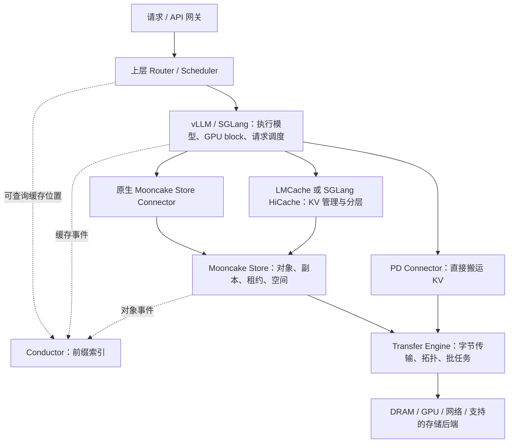

**阅读要点**：LMCache 是一条可选集成路径，不是所有 Mooncake 用户都必须经过的组件。Conductor 提供缓存位置查询，上层路由器仍需结合负载和 SLO 做决策。

论文中的全局调度器是系统设计的一部分；不能由“安装 Store 和 TE”推断已获得论文里的完整准入、预测和调度策略。

## 3. Store 部署与控制面/数据面

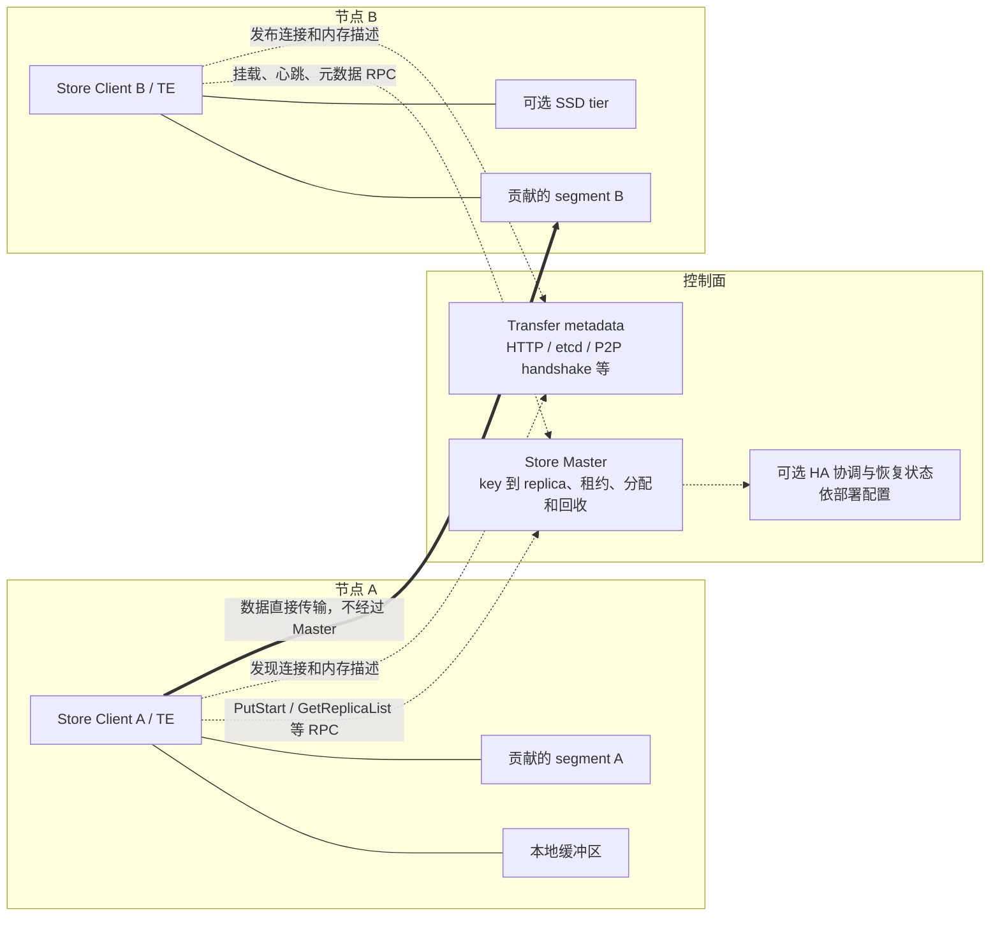

Master 的对象元数据与 TE 的连接/内存元数据是两个逻辑概念。内置 HTTP metadata server 可以与 Master 同进程，但职责没有合并。HA 使用 etcd 也不代表每个 KV 对象的 payload 或每次数据读取都经过 etcd。

Client 可以既是访问者又是资源贡献者；图中的 segment 属于相应进程/节点的资源。退出贡献者可能让该处缓存副本消失。

## 4. Put 正常与失败路径

以下是 C++ Store 普通内存副本路径的简化图；磁盘/DFS 等副本具有各自完成规则。

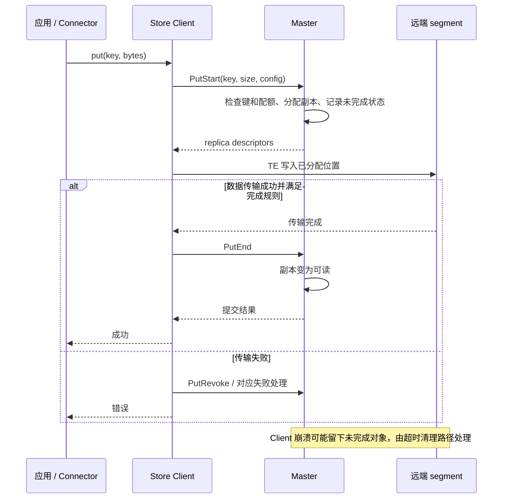

这个 start/end 协议让数据准备与发布可见性分离，但不应叫成跨对象数据库事务。读者不能使用仅分配而尚未完成的副本。

## 5. Get 与租约时序

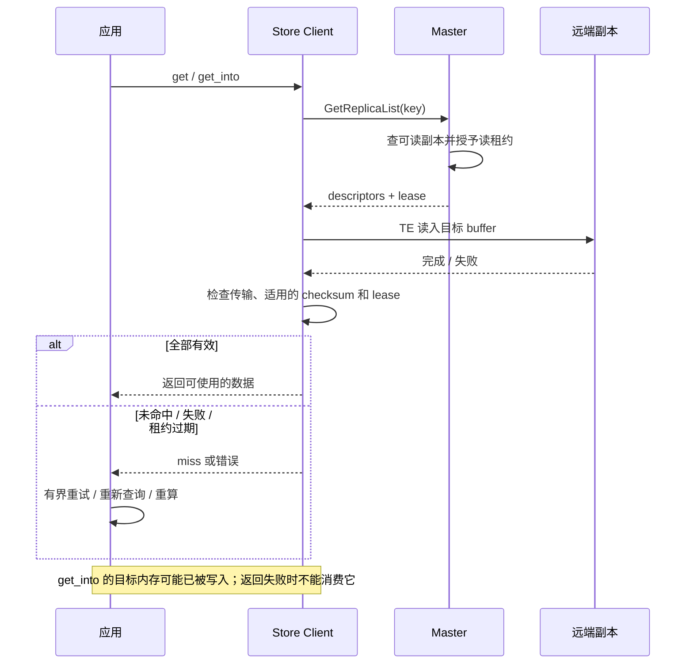

租约保护正常删除/淘汰窗口；最终是否成功还依赖实际 I/O、客户端时间判断和故障状态。不能把 descriptor 缓存无限期复用。

## 6. 请求运行图：缓存复用与 PD

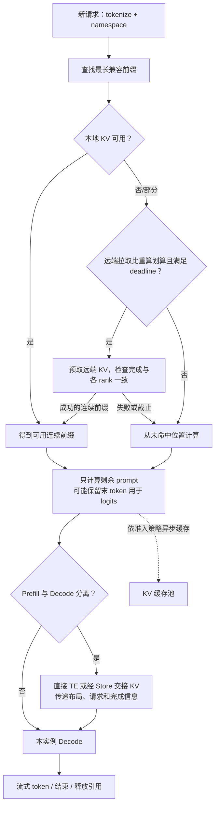

这张图是通用运行模型，不规定某一 Connector 的实际回调顺序。直接 TE 与 Store 交接是不同路径，部署时只能使用框架和版本实际支持的协议。

## 7. LMCache MP 数据流

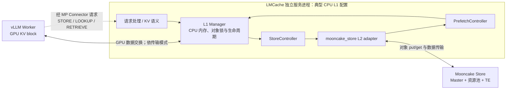

MP 请求通道不等于 KV 大块数据必须序列化后穿过 RPC。实际 GPU 数据交换依赖支持的模式、内存映射和同步实现。此图画的是 CPU L1 常见配置；MP 还有特定版本支持的 GDS L1 等选项。

## 8. 对象与缓冲区状态：两套不同的生命周期

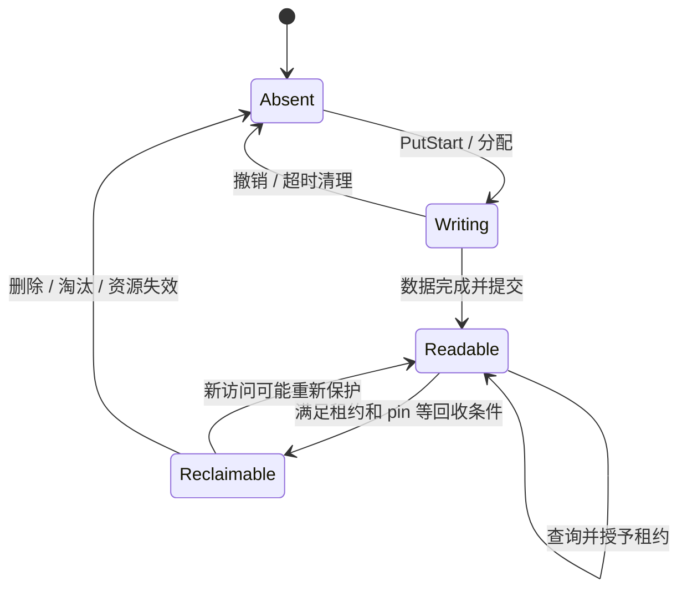

这是教学对象状态机，不是 `ReplicaStatus` 枚举的逐项映射。不同副本可以处于不同状态；“可回收”也不是读不到数据，而是已满足回收资格。

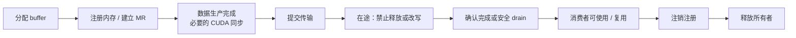

超时只是等待方停止等待的信号之一；释放前必须确认底层不会再访问该内存。缓存对象生命周期与本次传输 buffer 生命周期不能互相替代。

## 9. Page、chunk、object、slice 的关系

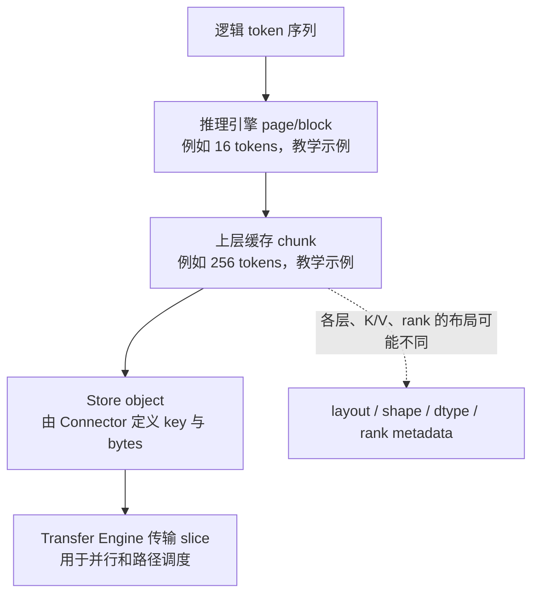

几个粒度不能混用：模型 attention window、引擎 page、LMCache chunk、Store object、TE slice 的职责不同。一个 chunk 是否包含所有层、某个 rank 或某种 packed 布局，必须看当前 Connector。

## 10. 缓存感知路由与过载

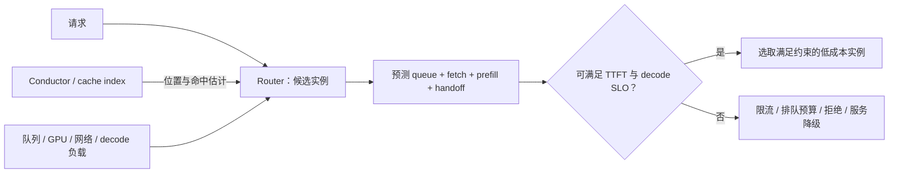

索引可能过期。路由命中预测是性能提示，不能代替 Store 读取与兼容性检查。最大化缓存命中率还必须考虑排队、热点与网络拥塞。
