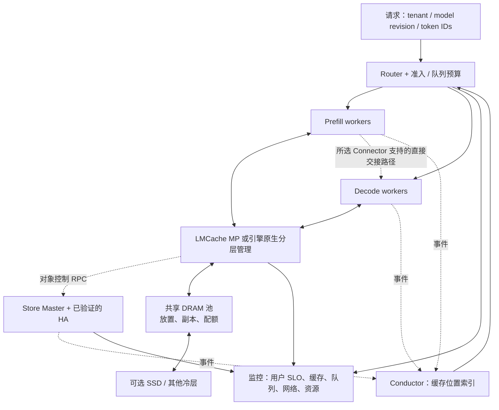

# 08 · 系统设计、毕业项目与参考资料

## 1. 设计题：为长上下文服务建设共享 KV Cache

先把需求问清楚：模型与版本数、平均/尾部输入输出长度、请求到达模式、前缀复用分布、TP/PP、TTFT/ITL SLO、硬件、数据丢失后的重算能力、租户隔离和成本上限。

下面用一组**教学假设**演算，所有数字都是规划示例：

| 输入 | 假设 |
|---|---|
| 模型 KV | `L=32, Hkv=8, d=128, BF16`，每 token 128 KiB |
| 请求 | 100 req/s，每个 prompt 8192 tokens |
| 复用 | 为简化，80% 请求复用完整 prompt，20% 产生全新上下文 |
| KV 大小 | 每请求 1 GiB；暂不计输出增长及 full-hit 的末 token 处理 |
| 保留目标 | 新增唯一上下文保留 300 秒；这是容量假设，不是读 lease TTL |
| 副本 | 实际获得 2 份，且满足预设 host 故障域约束 |
| 存储节点预算 | 每节点可分配给 Store segment 512 GiB，目标使用率不超过 70% |
| 带宽示例 | 每个参与传输端实测有效 payload 上限暂按 20 GiB/s |
| TP | TP=8，假设 KV 均匀分片；存储可按 rank 分对象 |

真实系统会有部分前缀复用、输出 KV、新旧版本并存、异步写入和冷热层，这些需在下一轮规划中加入。

## 2. 容量、带宽与元数据演算

### 2.1 容量

```text
新增唯一 KV = 100 × 20% × 1 GiB = 20 GiB/s
300 秒工作集 = 20 × 300 = 6000 GiB
两副本物理容量 = 12000 GiB
每节点目标使用容量 = 512 × 70% = 358.4 GiB
容量下界节点数 = ceil(12000 / 358.4) = 34
```

34 是该组假设下的容量下界，不是生产建议。512 GiB 指已扣除 OS/LMCache/staging 等资源后的 segment 预算；若它只是机器总内存，就必须重算。还需要预留节点故障、重建、碎片和工作集增长空间。

如果按同样副本数让更多冷数据下沉 SSD，可以减少 DRAM 容量需求，但会增加读取延迟、冷层带宽与元数据恢复复杂性。存储空间便宜不等于满足在线 SLO。

### 2.2 网络

```text
远端命中读流量 = 100 × 80% × 1 GiB = 80 GiB/s
新增写入的两份副本 = 20 × 1 × 2 = 40 GiB/s
示例 aggregate payload 流量 = 120 GiB/s
```

这里为简化假定命中都从远端拉取、两份写均跨网络，且逻辑传输只计一次，不把 sender TX 和 receiver RX 再相加。实际 local hit/同机副本能减少网络，prefetch、重试、重建与其他业务会增加网络。

仅服务 80 GiB/s 的读，在单端 20 GiB/s 假设下至少需要 4 个等效饱和服务端；这只是带宽算术下界，还需考虑负载偏斜、接收端、拓扑、双向竞争和尾延迟。容量下界与带宽下界分别算，最后取同时满足所有约束的部署。

PD 交接是否额外增加一份流量，要画实际路径：消费者读 Store 可能就是这次交接，直接 P→D 则可能独立发生。不要既把一次读取算成远端命中，又把同一字节重复算一次 PD。

### 2.3 对象数

若 chunk=256 tokens，则全模型 chunk 为 `256 × 128 KiB = 32 MiB`：

```text
6000 GiB / 32 MiB = 192000 个逻辑 chunk
若 TP=8 且每个 rank 独立对象：1536000 个对象键
两个副本增加 descriptor 和 payload，不一定使 key 数翻倍
```

假设每对象完整元数据的粗略估计为 512 bytes：

```text
1536000 × 512 bytes ≈ 0.73 GiB
```

512 bytes 只是占位参数，真实值必须通过内存 profile 测量；字符串、hash buckets、锁索引、组关系、复制任务和 allocator 都可能使总开销明显上升。增加 layer-wise 对象还可能进一步放大 key 数与 RPC。

## 3. 架构方案



图表示设计选项，不要求同时部署所有数据路径。先选一条端到端路径验证，再增加冷层和 HA，减少定位变量。

## 4. 六项关键决策与取舍

### 4.1 一致性与失败

采用模型 revision 和前缀语义构造不可变内容键。写时先分配、完成数据后发布；读时保护位置并校验完成条件。对象丢失降级重算；模型、布局或 checksum 不一致时拒绝使用该缓存。

对正在进行的读取，删除/淘汰要遵守保护条件；超时不直接触发 buffer free。Master 切换要有已验证的旧主隔离和恢复流程。

### 4.2 缓存准入

不把所有新 KV 都无条件写入冷层。结合长度、预估复用次数、计算收益和写成本做准入。保护高价值系统前缀，限制一次性长请求污染。准入策略可以放在上层，必须说明与 Store 回收策略的职责差异。

### 4.3 副本与热点

目标是实际跨故障域的副本，而不是只设置一个数。热点可动态加副本或提升到本地，冷对象减少冗余。需要限制复制带宽，否则故障重建和热点扩散反而冲击在线流量。

### 4.4 预取和路由

先估算 `queue + load + suffix prefill + handoff`，再根据 decode SLO 选节点。给每次预取 deadline；部分成功只能复用有效连续前缀，多 rank 必须一致。过期索引触发重新查询或重算，不成为正确性依据。

### 4.5 背压

分别为 lookup、fetch、write-back、复制和 GPU 加载设置有限在途量。到达率超过服务能力时明确准入/拒绝，而非无界积压。失败重试共享原请求预算，避免重试风暴。

### 4.6 隔离与成本

namespace 解决复用边界，tenant quota 解决资源公平，认证授权解决访问边界。共享组内复用可以节省资源，但对敏感租户要考虑跨请求 timing 信息。成本评估需计入 CPU 内存、网卡、网络、存储、运维和命中不足时额外 GPU 重算。

## 5. 故障设计矩阵

| 故障 | 保护行为 | 恢复路径 | 需要的证据 |
|---|---|---|---|
| Master 失联 | 有界等待/重连，避免无限占用 GPU buffer | 已配置 HA 发现新主，或恢复单 Master | 切换时间、错误分布、旧主行为 |
| 数据节点退出 | 读取失败不消费 buffer | 查询其他副本或重算，后台补副本 | 实际副本位置、回退成功率 |
| 单网卡故障 | 按当前 TE/TENT 能力重试/换路径 | 路径恢复、隔离坏设备 | 无损坏、带宽下降与尾延迟 |
| 冷层超时 | 到 deadline 停止等待并安全处理在途任务 | 改走热层/重算，限制后台积压 | TTFT、在途内存、取消/drain 行为 |
| 元数据事件滞后 | 路由预测不能直接消费数据 | 真实查找校验、索引恢复 | false-hit、路由偏差、恢复时长 |
| namespace 配错 | 拒绝不兼容布局或停止共享 | 修正 key/version，重新预热 | 负面兼容性用例不误命中 |

缓存系统允许“缓存不可用”，但要保证回退不会迅速耗尽 GPU。故障期间可能需要降低准入率或缩短等待预算。

## 6. 毕业项目验收

题目：**一个可解释的 Mooncake 共享 KV 缓存评估与设计报告**。

最终交付 6–10 页报告和可复现配置，至少包含：

1. 需求、硬件、版本、模型及兼容性边界。
2. 架构、读写、PD/缓存运行图与 buffer 所有权。
3. KV 容量、流量、对象数和 Master 预算。
4. 一条完整集成路径；没有 GPU 时用 TCP 和模拟替代，并清楚标注。
5. 冷/热及本地/远端消融；原始数据与样本量。
6. 一次失败路径及正确回退的证据。
7. 解释一个负结果，例如远端命中不值得、batch 太大拖慢 P99。
8. 结论的适用范围、当前瓶颈和下一步验证计划。

面试介绍结构可以是：“问题与约束 30 秒、架构 60 秒、正确性 60 秒、实验与负结果 90 秒、局限与取舍 60 秒”。

## 7. 阅读资料与证据索引

外部资料核对日期为 2026-10-24；`latest` 页面会变化。源码学习以本手册 commit 为基线，部署时另外锁定实际版本。优先阅读论文、官方设计和当前 API，博客用于解释背景。

| 来源 | 链接 | 读什么 / 用来支持什么 |
|---|---|---|
| S1 · FAST '25 正式论文 | [USENIX 页面](https://www.usenix.org/conference/fast25/presentation/qin)、[PDF](https://www.usenix.org/system/files/fast25-qin.pdf) | 问题、KV-centric 架构、SLO 调度、评估假设 |
| S2 · arXiv 技术报告 | [2407.00079](https://arxiv.org/abs/2407.00079) | 版本演进；不要与 FAST 版混用性能数字 |
| S3 · 当前 Mooncake 架构 | [Architecture](../design/architecture.md) | 开源组件的职责与生态关系 |
| S4 · Store 设计 | [Store](../design/store/mooncake-store.md)、[Metadata](../design/store/metadata-management.md) | Put/Get、租约、副本、淘汰与元数据位置 |
| S5 · Store 源码基线 | [client_service.cpp](https://github.com/kvcache-ai/Mooncake/blob/dd1217b6c461491e7c73ff29b4ffad215e0a9ac0/mooncake-store/src/client_service.cpp) | 当前重复 Put、Get 检查和批写完成规则 |
| S6 · TE 设计/API | [设计](../design/transfer-engine/index.md)、[Python API](../api-reference/python/transfer-engine.md) | segment、注册、batch、协议与拓扑 |
| S7 · Store Python API | [API](../api-reference/python/mooncake-store.md) | setup、返回值、BufferPool、pin 与后端差异 |
| S8 · 部署/HA | [Deployment](../deployment/mooncake-store-deployment-guide.md) | master/client、HA、snapshot/OpLog、观测和配置 |
| S9 · 缓存共享边界 | [Sharing and Isolation](../deployment/kv-cache-sharing-and-isolation.md) | namespace、model/release、cache salt、tenant |
| S10 · vLLM 前缀缓存 | [设计](https://docs.vllm.ai/en/latest/design/prefix_caching/) | 链式哈希、完整块、额外身份信息和隔离 |
| S11 · PagedAttention | [论文](https://arxiv.org/abs/2309.06180) | 分页、共享、copy-on-write 与 GPU KV 管理 |
| S12 · FlashAttention | [论文](https://arxiv.org/abs/2205.14135) | IO-aware attention，与 KV 存储的职责区别 |
| S13 · LMCache 总体架构 | [官方架构](https://docs.lmcache.ai/developer_guide/architecture.html) | 引擎接口、分层与组件背景；结合 MP 文档读 |
| S14 · LMCache MP L2 | [Secondary KV Storage](https://docs.lmcache.ai/mp/l2_storage/index.html) | L1/L2、StoreController、PrefetchController |
| S15 · LMCache MP Mooncake | [Adapter](https://docs.lmcache.ai/mp/l2_storage/mooncake_store.html) | native 扩展、RDMA 的 L1 描述符要求 |
| S16 · 仓库 MP 集成 | [MP 指南](../deployment/integrations/lmcache/vllmv1-lmcache-mp-integration.md) | 完整服务顺序、Connector、版本要求 |
| S17 · LMCache 旧模式 | [Mooncake backend](https://docs.lmcache.ai/kv_cache/storage_backends/mooncake.html)、[历史 connector 博客](https://blog.lmcache.ai/en/2025/04/22/extending-lmcache-remote-connectors-mooncakestore-as-an-example/) | 解释旧组件；不直接作为 MP 启动说明 |
| S18 · CacheBlend | [当前文档](https://docs.lmcache.ai/kv_cache_optimizations/cacheblend.html)、[论文](https://arxiv.org/abs/2405.16444) | 非前缀复用、选择性重算与质量 |
| S19 · HiCache | [设计](../design/hicache-design.md)、[快速部署](../deployment/integrations/sglang/hicache-quick-start.md) | 预取、写回、TP 同步、布局 |
| S20 · Conductor | [设计](../design/conductor/conductor-architecture-design.md) | 缓存事件、全局索引与路由职责 |
| S21 · 性能与调优 | [Store benchmark](../performance/mooncake/storage-benchmark.md)、[TE 调优](../design/transfer-engine/transfer-engine-bench-tuning.md) | 原始测量方式和硬件/工作负载前提 |
| S22 · 后续进阶 | [TENT](../design/tent/overview.md)、[Store-RS](../design/store/store-rs/index.md) | 研究当前实现分支的差异，避免套用经典 TE/Store 细节 |

### 建议阅读顺序

第一遍：S3 → 本手册 KV 基础 → S1 → S4 → S6。第二遍：S5/S7 对照代码 → S10 → S14/S15/S16 → S19。项目阶段：S8/S9/S20/S21。P2 进阶留在核心验收之后。

### 读论文的四个问题

1. **它解决的是哪个瓶颈？** 计算、容量、通信、调度还是过载？
2. **依赖哪些假设？** 模型、重复前缀、硬件、SLO、可重算数据。
3. **实验有没有排除其他解释？** 相同硬件/预算、相同命中条件、负载与基线是否公平。
4. **如何落到代码和当前工作负载？** 找到对应模块；不能把论文模拟效果直接当自己的实测结论。

## 8. 面向岗位的最终优先级

KV Cache 存储岗位应把最多时间放在 **对象正确性、buffer 生命周期、资源池与分配、分层 I/O、网络成本、兼容性和端到端收益**。推理 Infra 综合岗位在此基础上强化调度、PD、GPU execution 和 SLO。高性能通信岗位则进一步深入 verbs、QP/CQ、拓扑、NUMA、GPU 可见性和故障恢复。

基础算法能力也不能遗漏：哈希表/树、LRU、并发队列、引用计数、状态机、时间/空间复杂度，以及 C++ RAII、锁顺序、原子操作与 Python/native 边界。面试中能把这些基础与真实数据路径联系起来，比孤立背诵框架名更有说服力。
