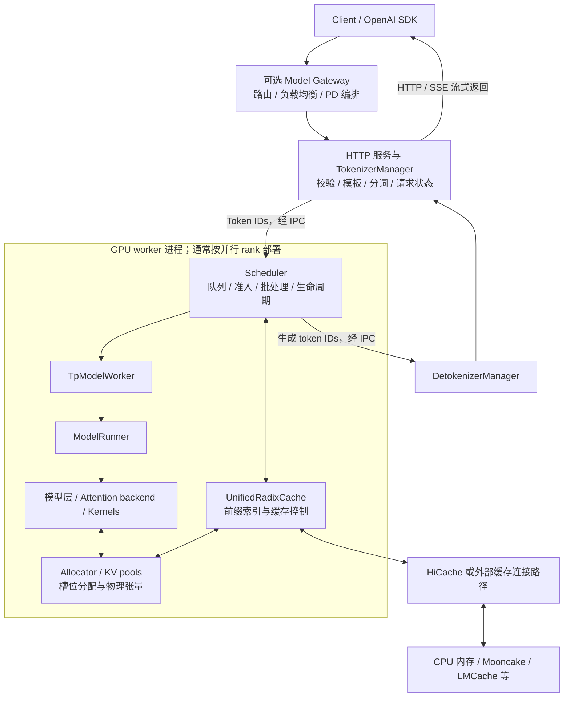
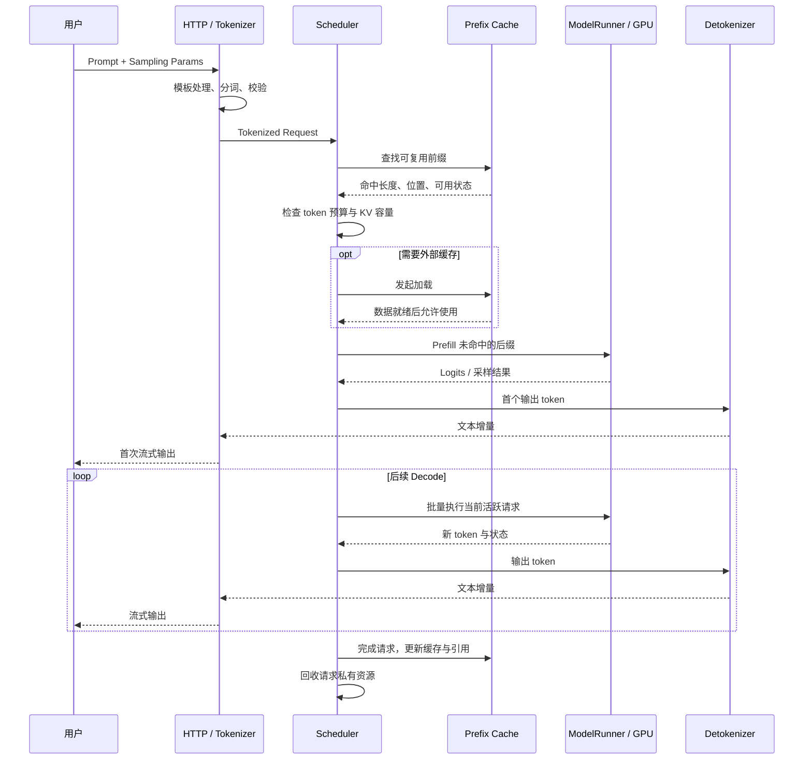
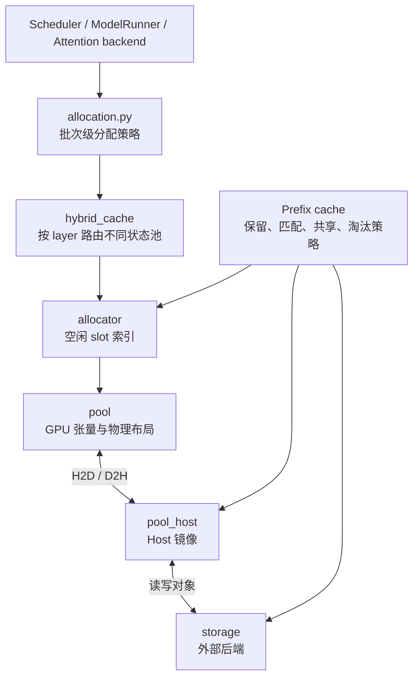
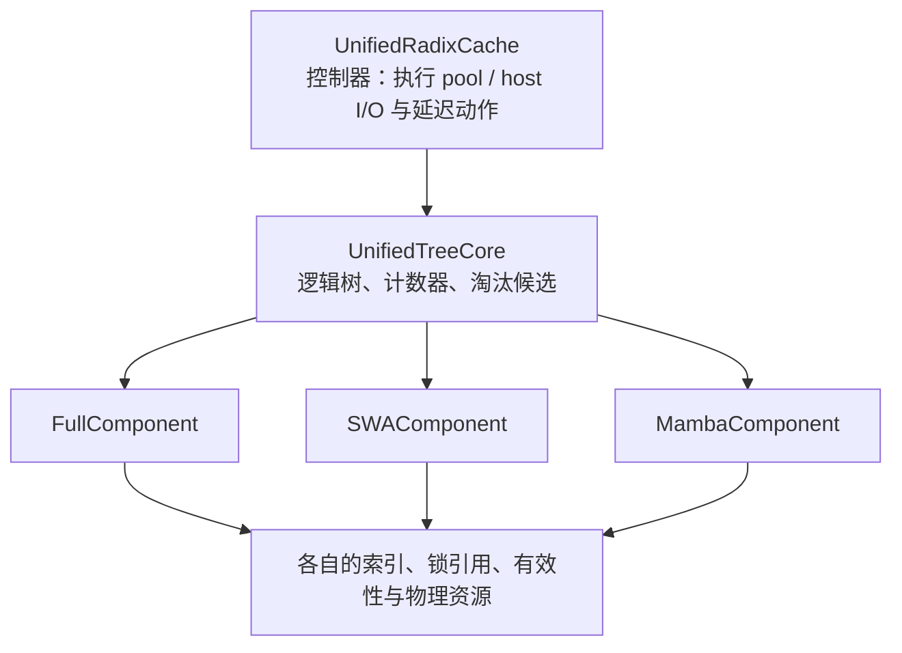

# SGLang 架构、运行图与源码路线

[返回导航](README.md) · [推理基础](04-inference-fundamentals.md) · [KV Cache](05-kv-cache.md)

## 1. 职责划分

- 服务层：校验输入、模板处理、分词、请求状态与输出返回。
- Scheduler：决定哪些请求运行，形成 batch，协调生命周期与缓存。
- ModelRunner：组织模型执行、Attention backend、kernel 和 GPU 资源。
- 缓存系统：管理 KV/状态的索引、分配、共享、加载、备份与回收。

这些是职责边界，不是“一类一个进程”。例如常见路径中 Scheduler、TpModelWorker 与 ModelRunner 位于同一个 GPU worker 进程。

## 2. 常见 Python 文本生成路径



图中缓存路径是可选方案的概览，不能据此同时开启所有缓存功能。不同部署还会加入 DP controller、多 Tokenizer、PP 和其他组件。

## 3. 一次请求的运行时序



Prefill 通常已产生首个输出 token 所需的 logits，不应统一把首 token 算作额外 Decode 步骤。图中没有展开 speculative、embedding、PD 等专用路径。

## 4. 三类运行时对象

| 对象 | 关注点 | 阅读问题 |
|---|---|---|
| `Req` | 单个请求的输入、输出、采样、结束条件、缓存关联 | 哪些字段随每轮生成更新？ |
| `ScheduleBatch` | 调度决策与批内请求状态 | 当前批次为什么能容纳这些请求？ |
| `ForwardBatch` | 模型和 backend 所需的 tensor、索引与模式信息 | GPU 执行需要哪些布局与长度元数据？ |

不要把三者当作同一份结构的不同名字。它们服务于不同的抽象层和执行阶段。

## 5. 正常与重叠调度

正常循环的教学抽象：

```python
while running:
    ingest_requests()
    plan = choose_next_batch(running_batch, last_batch)
    batch = plan.batch_to_run
    if batch is not None:
        result = run_batch(batch)
        process_batch_result(batch, result)
```

以上是伪代码，用于说明循环顺序，不是独立可运行程序。

当前源码可从以下函数开始：

- `event_loop_normal`
- `event_loop_overlap`
- `get_next_batch_to_run`
- `run_batch`
- `process_batch_result`

[Scheduler 实现](../../python/sglang/srt/managers/scheduler.py)

重叠循环会保留批次和结果队列，在 GPU 执行时推进部分 CPU 工作，并延后处理某些结果。需要关心：

1. 哪些结果是下一轮真正依赖的。
2. 哪些路径必须关闭或缩小 overlap。
3. 哪个 event/stream 保证读写顺序。
4. 旧 batch 引用何时可以释放。
5. 语法约束等采样依赖是否要求先处理上一轮结果。

```text
概念时间线：

CPU： [准备 batch n] [处理旧结果 / 准备后续工作] [处理 batch n 结果]
GPU：                [执行 batch n...........] [执行下一批......]

CPU 与 GPU 有重叠，不代表相邻生成步骤没有依赖。
```

## 6. 内存与缓存分层



构建层还负责形状、容量、dtype 与对象创建。不能让底层 pool 反过来承担所有调度和命中策略。

[内存模块分层说明](../../python/sglang/srt/mem_cache/README.md)

## 7. Unified Cache 的结构



核心思想是“树决定，控制器执行”。逻辑树维护前缀结构；组件处理状态差异；控制器协调实际资源和 I/O。

Full、SWA、Mamba 的淘汰数据结构和规则不完全相同。当前组件文档指出 Full 使用可淘汰叶集合，辅助组件有自己的 LRU；不应把所有组件概括为同一个简单 LRU。

[组件架构与 API](../../python/sglang/srt/mem_cache/unified_cache/components/README.md)

## 8. RuntimeContext 的阅读提示

当前仓库把进程级运行状态组织到 RuntimeContext：

- 原始 `ServerArgs`：启动输入与来源记录。
- 解析后的 namespace 配置：运行决策读取的配置。
- Runtime flags：运行状态，不只是静态参数。
- Resources：stream、buffer 等进程资源。
- Per-forward：一次前向执行范围内的状态。
- Parallel：rank、group 与并行规模等信息。

理解作用域很重要：某个进程内的配置或状态修改不会自动传播到其他进程；每个 worker 的专属值也不能随意写成所有 worker 共用的全局状态。

阅读依据：[Runtime context 项目说明](../../.agents/skills/sglang-runtime-context/SKILL.md)。本文仅解释设计，不修改运行时配置。

## 9. 源码阅读路线

| 顺序 | 源码入口 | 需要回答的问题 |
|---|---|---|
| 1 | [TokenizerManager](../../python/sglang/srt/managers/tokenizer_manager.py) | 输入如何变成内部请求？响应如何关联到用户？ |
| 2 | [Scheduler](../../python/sglang/srt/managers/scheduler.py) | 请求如何入队？何时 Prefill、何时 Decode？ |
| 3 | [ScheduleBatch / Req](../../python/sglang/srt/managers/schedule_batch.py) | 长度、状态与 KV 索引如何表示？ |
| 4 | [Schedule policy](../../python/sglang/srt/managers/schedule_policy.py) | 优先级与预算怎样影响复用和公平性？ |
| 5 | [TpModelWorker](../../python/sglang/srt/managers/tp_worker.py) | 调度数据如何进入执行层？ |
| 6 | [ModelRunner](../../python/sglang/srt/model_executor/model_runner.py) | 模型、显存、backend、Graph 如何组织？ |
| 7 | [ForwardBatch](../../python/sglang/srt/model_executor/forward_batch_info.py) | Kernel 需要哪些元数据？ |
| 8 | [Llama 模型实现](../../python/sglang/srt/models/llama.py) | Attention、MLP、残差与并行线性层怎样组合？ |
| 9 | [内存模块说明](../../python/sglang/srt/mem_cache/README.md) | allocator、pool、prefix cache 的职责边界？ |
| 10 | [缓存工厂](../../python/sglang/srt/mem_cache/registry.py) | 当前配置选择了哪条缓存路径？ |
| 11 | [UnifiedRadixCache](../../python/sglang/srt/mem_cache/unified_radix_cache.py) | 匹配、引用、加载、回写如何协调？ |
| 12 | [HiCacheController](../../python/sglang/srt/managers/cache_controller.py) | I/O 队列、完成状态与资源生命周期在哪里？ |
| 13 | [PD Prefill](../../python/sglang/srt/disaggregation/prefill.py) / [Decode](../../python/sglang/srt/disaggregation/decode.py) | 如何握手、等待数据、进入 Decode？ |
| 14 | [DetokenizerManager](../../python/sglang/srt/managers/detokenizer_manager.py) | token 如何恢复为流式文本？ |

## 10. 阅读笔记模板

```text
模块：
当前源码版本：
入口函数：
输入 / 输出：
持有状态：
状态修改者：
同步与可见性保证：
资源释放条件：
异常 / 取消路径：
关联测试：
尚未确认的问题：
```

推荐从现有测试学习边界条件：

- [Radix 缓存命中测试](../../test/registered/radix_cache/test_radix_cache_hit.py)
- [Unified Radix 树核心测试](../../test/registered/unit/mem_cache/unified_radix_cache/test_unified_radix_cache_core.py)
- [Unified Radix 加载恢复测试](../../test/registered/unit/mem_cache/unified_radix_cache/test_unified_radix_cache_load_back.py)

测试是否能在 CPU 环境直接运行取决于其实际依赖，不能只凭 `unit` 目录名称判断。
