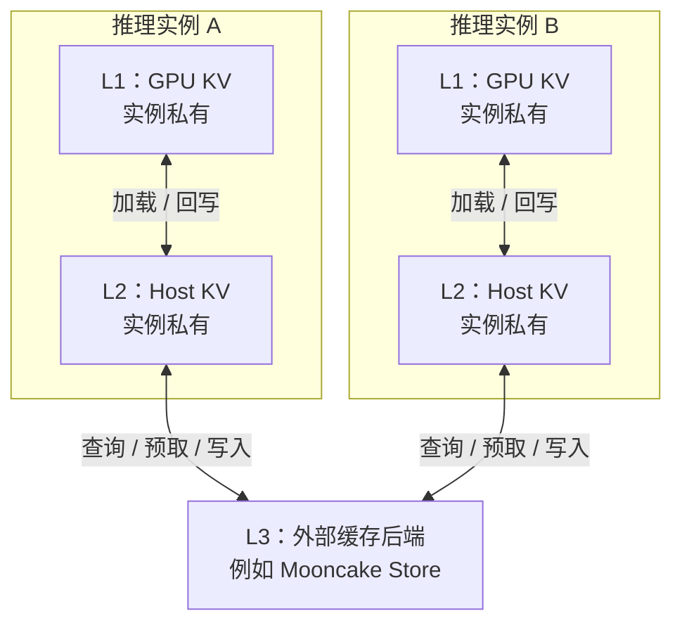
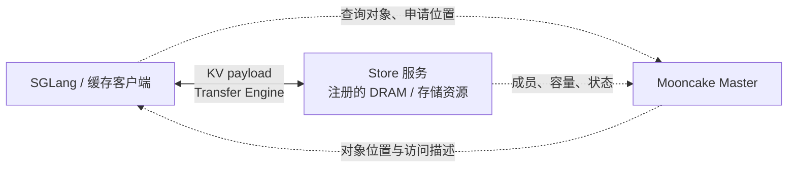
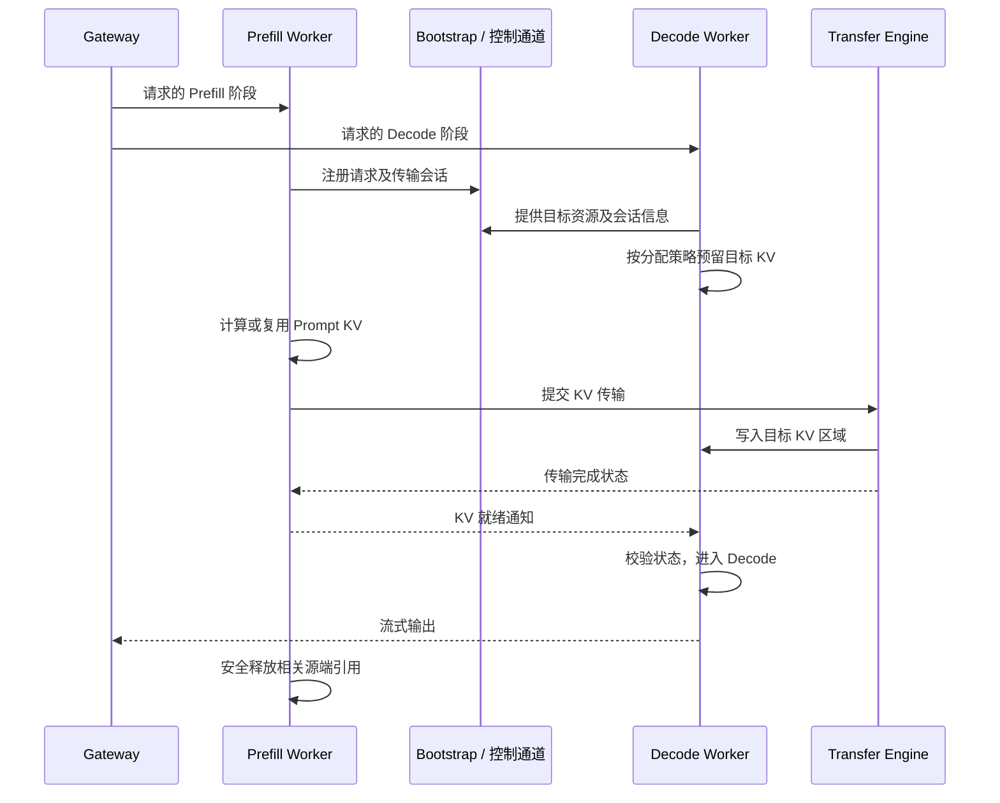

# HiCache、Mooncake、LMCache 与 PD 分离

[返回导航](README.md) · [KV 基础](05-kv-cache.md) · [实验手册](07-hands-on-labs.md)

本篇重点区分缓存管理、数据传输、共享存储和推理调度。下文的框架支持范围以本手册记录的源码版本为准。

## 1. HiCache 的常规层次



### 1.1 共享范围

| 层级 | 介质 | 共享范围 |
|---|---|---|
| L1 | GPU 内存 | 推理实例私有 |
| L2 | Host 内存 | 推理实例私有，同机实例也不自动共享 |
| L3 | 外部后端 | 由后端部署、命名空间与格式配置决定 |

增大 `hicache-ratio` 不会自动把其他机器的 Host 内存汇聚成当前实例的 L2。跨实例复用通常依赖共享 L3。

本地 file backend 也不会自动成为集群共享缓存；即使有共享挂载，还需要验证一致性、格式和性能。

[HiCache 官方设计的仓库副本](../../docs/docs/advanced_features/hicache_design.mdx)

### 1.2 请求的数据流

```text
匹配本地 GPU / CPU 前缀
    ↓
对剩余连续前缀查询 L3
    ↓
按策略预取到本地 Host
    ↓
把可用 KV 加载到 GPU
    ↓
计算剩余 Prefill
    ↓
按策略备份新生成的状态
```

元数据可以表明外部对象存在，但对象仍需被取回并满足可见性条件。不能把“查到”当作“加载完成”。

## 2. HiCache 策略

| 机制 | 选项 | 优点 | 成本 |
|---|---|---|---|
| 写策略 | `write_through` | 更早产生下层副本，利于共享 | 更高写流量与内存带宽消耗 |
| 写策略 | `write_through_selective` | 优先备份较热数据 | 热度判断和首次复用机会 |
| 写策略 | `write_back` | 推迟备份，减少部分无效写入 | 淘汰阶段的压力和同步 |
| 预取结束 | `best_effort` | 尽量不额外等待 | 可能只得到部分缓存 |
| 预取结束 | `wait_complete` | 尽量完成预取 | 慢存储可能拉长 TTFT |
| 预取结束 | `timeout` | 设置等待预算 | 需要按 workload 调整 |

这些写策略描述备份时机，不意味着所有下层写入都已在请求返回前同步完成。

`timeout` 的预算必须结合 SLO 和实际数据量设置；学习时不要把文档默认值当成生产最优值。

## 3. 页面、布局与异步传输

GPU 计算按层推进，外部存储通常希望一次传输整页。`layer_first`、`page_first`、`page_first_direct` 等布局协调这两种访问方式。

关注以下问题：

1. 一个对象包含哪些层、heads、token。
2. 是否需要 gather/scatter 或转置。
3. 传输粒度是否过小。
4. Host 内存是否 pinned、是否注册给传输引擎。
5. GPU 能否在计算某一层时预取下一层需要的数据。
6. 用什么 event 或完成计数保证消费顺序。

“支持异步”不等于“传输已被完全隐藏”。应该在 trace 中验证 compute 与 transfer 的真实重叠。

### 3.1 多 rank 一致性

各 rank 可能命中或加载了不同长度，需要达成安全的共同前缀边界。例如以参与 rank 的最短成功长度作为可用范围。

不仅长度需要一致，collective 的顺序和参与 rank 也必须一致，否则可能挂起。

### 3.2 Host 内存预算

`hicache-ratio` 相对于设备缓存池，而不是简单相对于整张 GPU 显存。配置 `hicache-size` 时还要理解每 rank 的语义，并累计节点总量。

扩大缓存会增加物理内存、锁页和其他资源压力；容量越大，命中收益不一定线性增加。

## 4. Mooncake：Transfer Engine 与 Store

| 组件 | 解决的问题 | 核心抽象 |
|---|---|---|
| Transfer Engine | 已知源、目标 buffer 之间如何高效传输 | Segment、注册内存、BatchTransfer、传输后端、完成状态 |
| Mooncake Store | 对象在哪里、放到哪里、是否仍有效 | Object key、Master、placement、replica、lease、eviction |

Transfer Engine 可以独立用于 PD KV 移交，不要求一定使用 Mooncake Store。

### 4.1 控制与数据平面



Master 管理目录、资源和对象状态；大块 KV payload 在拥有源与目标 buffer 的进程之间直接传输，通常不经过 Master 中转。

### 4.2 必学的底层知识

- RDMA 注册内存、访问地址和 key。
- GPUDirect RDMA 的硬件、驱动和拓扑条件。
- GPU、NIC、CPU、NUMA 的亲和性。
- 多 NIC 聚合与实际瓶颈。
- 小消息延迟、大对象吞吐和批量提交。
- TCP 与 RDMA 的适用边界。
- 完成通知、重试、失效地址和超时。

Zero-copy 表示减少特定路径的中间拷贝，数据仍然占用网络和内存总线，也仍有 CPU 控制开销。

### 4.3 缓存持有者与故障

Store 的容量来自实际贡献的资源，不是无限容量。DRAM 缓存也不等于持久化数据库。

如果 SGLang 进程本身贡献 Store 内存，该进程退出会失去这部分缓存。验证推理重启后的复用时，应由独立 Store 持有数据，并确认写入已完成。

副本和更慢存储层可以改善容量与可用性，但需要实际部署、策略和版本支持，不能把“支持副本”理解成所有对象始终有足够副本。

### 4.4 租户隔离

SGLang 的 Mooncake 接入可传递 `tenant_id`，但仅设置该值不保证严格隔离。当前说明要求 Master 启用对应多租户模式并配置租户配额策略；关闭严格模式时的行为需要核对。

[Mooncake 接入说明](../../python/sglang/srt/mem_cache/storage/mooncake_store/README.md)

## 5. LMCache：缓存中间件与独立服务

当前 SGLang 路径：

```text
Scheduler
   ↓
LMCacheUnifiedRadixCache
   ↓
UnifiedLMCacheMPConnector
   ↓
独立 LMCache server
   ↓
本地缓存与可选外部存储
```

外部 KV 到达 GPU 并满足就绪条件后，才能发布为可消费的设备状态。独立服务可以在推理进程重启后继续保留其拥有的缓存。

源码与示例：

- [LMCacheUnifiedRadixCache](../../python/sglang/srt/mem_cache/storage/lmcache/lmcache_unified_radix_cache.py)
- [接入说明](../../python/sglang/srt/mem_cache/storage/lmcache/README.md)
- [MP 配置示例](../../python/sglang/srt/mem_cache/storage/lmcache/example_config_mp.yaml)

### 5.1 命名差异

HiCache 的 L1 指 GPU，L2 指实例 Host 缓存。

当前 LMCache 多进程文档中的 L1 默认指服务管理的 CPU 缓存，外部后端称 L2。讨论组合架构时直接使用“GPU、CPU、外部存储”，比仅说 L1/L2 更清晰。

### 5.2 当前 SGLang 兼容限制

当前工作区的 LMCache 校验包含：

- 与 `--enable-hierarchical-cache` 互斥。
- 与统一缓存 external linker 开关互斥。
- 不能同时关闭 radix cache。
- 暂不支持投机解码。
- 暂不支持 Attention DP。
- 暂不支持 DCP size 大于 1。
- 暂不支持 streaming session。
- 不接受 HiCache 专用的 `buffer_only` Host 模式。
- 当前只支持 Prefill/Decode colocated 调度，不支持 PD 分离模式。

这些限制属于当前集成版本，不能推广成 LMCache 框架的永久限制，也不能用 LMCache 在其他引擎上的支持情况覆盖本地代码校验。

[兼容性校验源码](../../python/sglang/srt/arg_groups/kv_cache_hook.py)

### 5.3 CacheGen 与 CacheBlend

- CacheGen：研究 KV 压缩与传输，关注体积、编解码、质量和实际关键路径成本。
- CacheBlend：研究非前缀文本块复用，通过选择性重计算处理上下文变化带来的依赖。

标准因果 Attention 下，同一文档块放到不同前文后 KV 会变化。直接拼接独立 KV 不能保证原始计算语义。

CacheBlend 的引擎、模型和接入路径要单独验证。LMCache 有这项能力，不等于当前 SGLang connector 自动支持。

## 6. 三种组件如何选型

| 维度 | SGLang HiCache | Mooncake | LMCache |
|---|---|---|---|
| 层次 | 引擎内部的分层缓存机制 | 传输与分布式缓存基础设施 | 引擎与存储之间的缓存中间件 |
| 执行模型 | 由 SGLang 执行 | 不执行 | 不执行 |
| 调度关系 | 与 SGLang 缓存/调度紧密配合 | TE/Store 不接管整个引擎调度 | 通过 connector 配合引擎 |
| 典型组合 | HiCache → Mooncake Store | 给 HiCache 或其他缓存层提供能力 | SGLang → LMCache → 可选 Mooncake Store |
| 当前入口 | `--enable-hierarchical-cache` | HiCache backend 或 PD transfer backend | `--enable-lmcache` + 独立服务 |
| 学习重点 | 树、Host/GPU 状态、异步 I/O | 传输、对象管理、集群资源 | Connector、服务生命周期、存储插件 |

### 6.1 选型建议

| 需求 | 优先考察 |
|---|---|
| 深入 SGLang 原生前缀与 Host 缓存机制 | Unified Cache + HiCache |
| 多实例共享长前缀，已有高性能网络 | HiCache + Mooncake Store |
| 研究独立缓存服务与多种存储插件 | LMCache 及当前引擎 connector |
| 单纯实现 P/D 间 KV 搬运 | Transfer Engine / 相应传输 backend |
| RAG 非前缀块复用 | CacheBlend 等专门方法，单独做质量与集成验证 |

LMCache 官方提供 Mooncake Store 后端，所以二者可以组合；这不等于当前 SGLang 可以同时开启 HiCache 和 LMCache。

## 7. 什么时候加载缓存比重算划算

$$
T_{\text{saved-prefill}}>
T_{\text{lookup}}+
T_{\text{unhidden-transfer}}+
T_{\text{layout/decode}}+
T_{\text{extra-sync}}
$$

左侧应测量实际节省的 Prefill 时间。命中一半 token 不一定节省一半 Prefill 时间，因为未命中 token 仍需读取前缀做 Attention。

### 7.1 传输下界示例

使用 [05](05-kv-cache.md) 的 8K、1 GiB KV 例子：

- 200 Gb/s = 25 GB/s。
- 理想传输时间为 \(2^{30}/(25\times10^9)\)，约 43 ms。
- 如果还要以同样有效速率从 Host 到 GPU，完全串行时两段仅数据搬运约 86 ms。
- 实际还包含协议、排队、布局转换、同步、争用。
- 流水重叠可降低关键路径暴露时间，但必须测量。

这是理论示例，不是 Mooncake 或 LMCache 的实测性能。

### 7.2 缓存指标

| 指标 | 作用 |
|---|---|
| 请求命中率 | 有多少请求命中任何缓存 |
| Token 命中率 | 复用了多少输入 token |
| 各层命中率 | GPU、Host、外部来源 |
| 实际少计算 token 数 | 命中是否真正减少计算 |
| 查到但未使用 token 数 | 无效预取、超时或准入变化 |
| 每请求传输字节 | 带宽需求 |
| 查找、加载、等待耗时 | 新增成本 |
| TTFT/ITL 分位数、Goodput | 用户实际收益 |

## 8. PD 分离

PD 将 Prefill 与 Decode 放到不同资源池，减少干扰，并允许独立选择并行和扩缩容策略；代价是 KV 移交和请求编排。



这是概念时序，真实步骤可重叠，并受分配策略影响。

### 8.1 资源预留

当前文档中的默认 `early` 策略较早预留 Decode KV 槽位。

`prefill_complete` 推迟到 Prefill 完成后再分配，可减轻长 Prefill 占住 Decode 资源的问题，但：

- 源端 KV 可能保留更久。
- 会失去部分 chunked Prefill 与 KV 传输重叠。
- 存在对传输后端、并行规模和其他功能的限制。
- 双方版本和策略必须一致。

不要把该策略当作通用吞吐优化。部署前逐项核对 [当前 PD 文档](../../docs/docs/advanced_features/pd_disaggregation.mdx)。

### 8.2 收益条件

比较：

$$
\text{减少的干扰与资源配置收益}
\quad\text{与}\quad
\text{新增传输、排队、编排、资源占用成本}
$$

短输入、小模型、低负载、弱互联下，PD 可能没有收益。P/D 数量应根据输入/输出分布、阶段服务能力和 SLO 配置，不只根据平均 GPU 利用率。

## 9. 正确性与故障设计

下面是设计要求，不代表每个后端都默认实现相同的自动降级：

1. 可重算的输入前缀缓存失效时，可以选择重算。
2. 不完整或版本不匹配的 KV 不能继续消费。
3. 活跃 Decode 状态丢失可能需要重放或终止，不是普通 cache miss。
4. 超时重试需避免旧写入覆盖新会话的 buffer。
5. 取消后必须处理在途 I/O 的引用和完成状态。
6. 集群升级应隔离不兼容的模型版本、KV dtype 和 layout。
7. 共享缓存可能包含用户输入相关状态，应有访问控制和租户策略。

## 10. 源码路线与资料

- [HiCache 设计](../../docs/docs/advanced_features/hicache_design.mdx)
- [HiCacheController](../../python/sglang/srt/managers/cache_controller.py)
- [Mooncake Store 接入](../../python/sglang/srt/mem_cache/storage/mooncake_store/README.md)
- [Mooncake PD 连接](../../python/sglang/srt/disaggregation/mooncake/conn.py)
- [LMCache connector 适配层](../../python/sglang/srt/mem_cache/storage/lmcache/lmcache_unified_radix_cache.py)
- [PD Prefill](../../python/sglang/srt/disaggregation/prefill.py)
- [PD Decode](../../python/sglang/srt/disaggregation/decode.py)

外部官方资料集中在 [09](09-references-and-assessment.md)。
