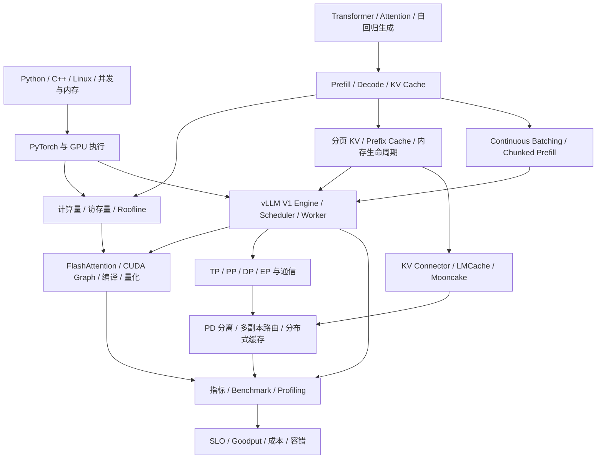
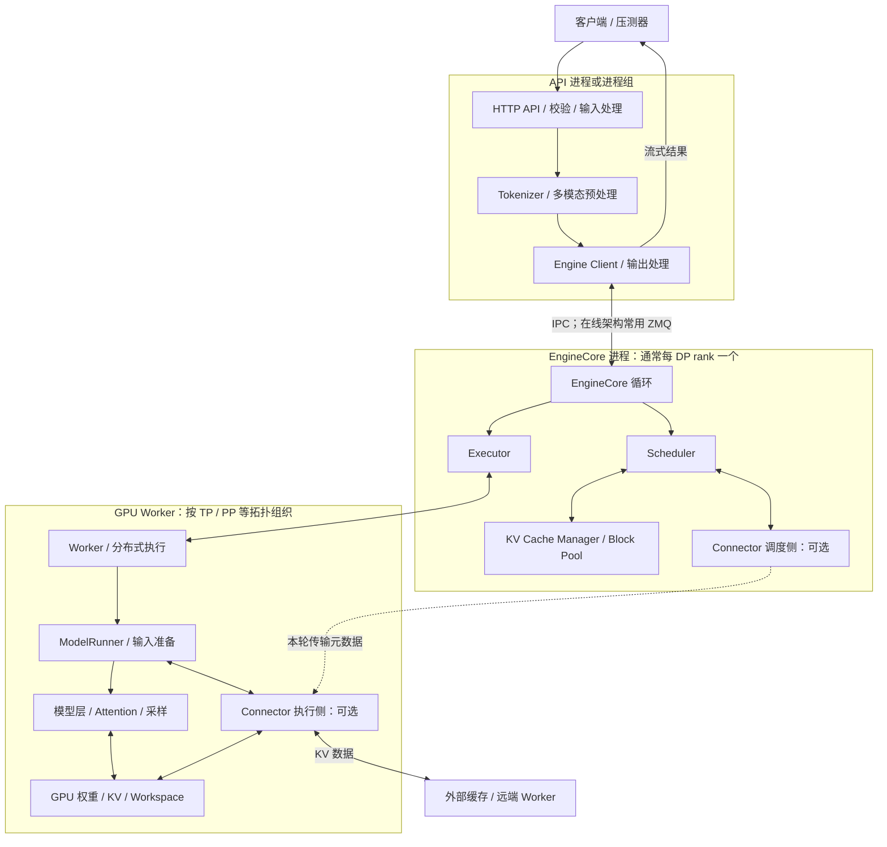
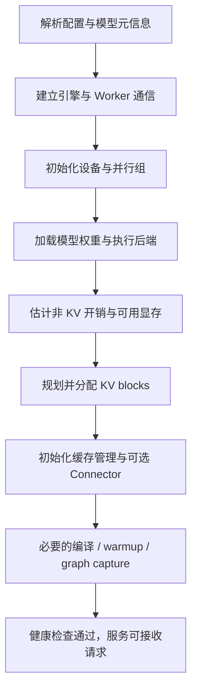
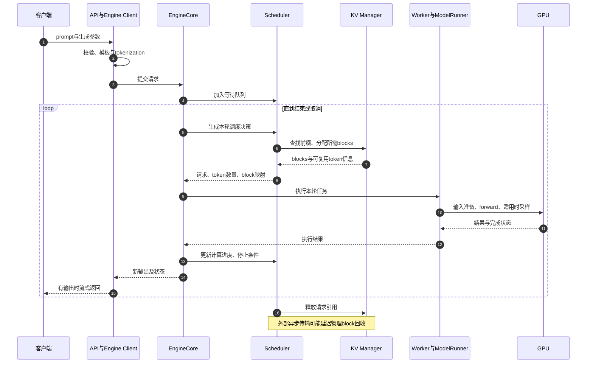
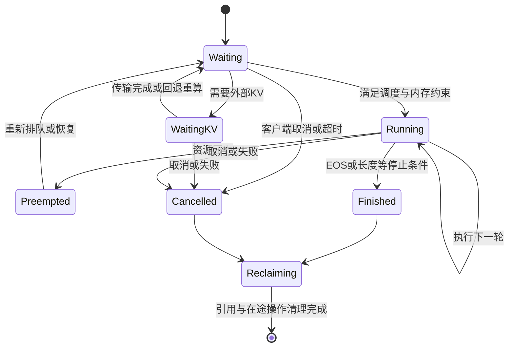
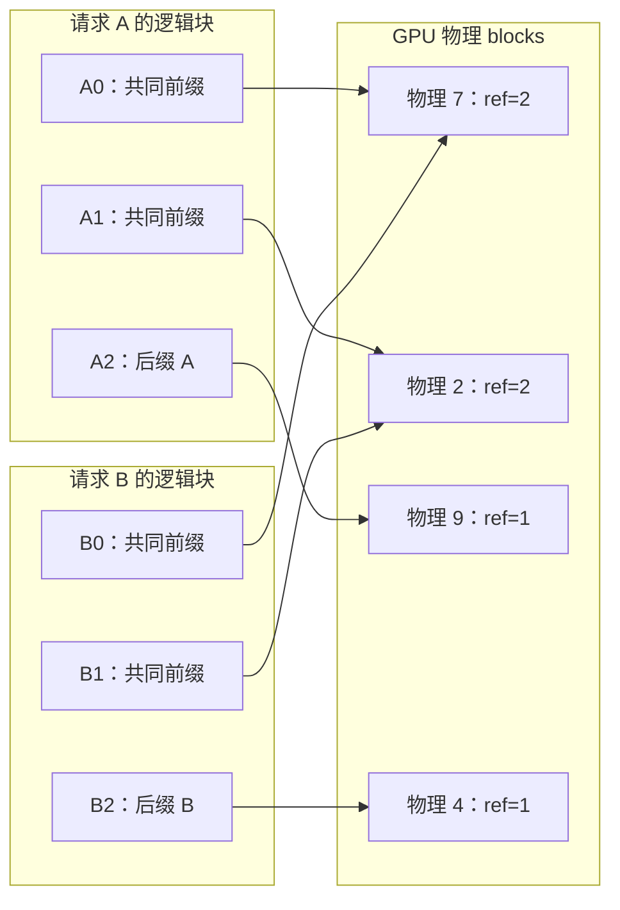
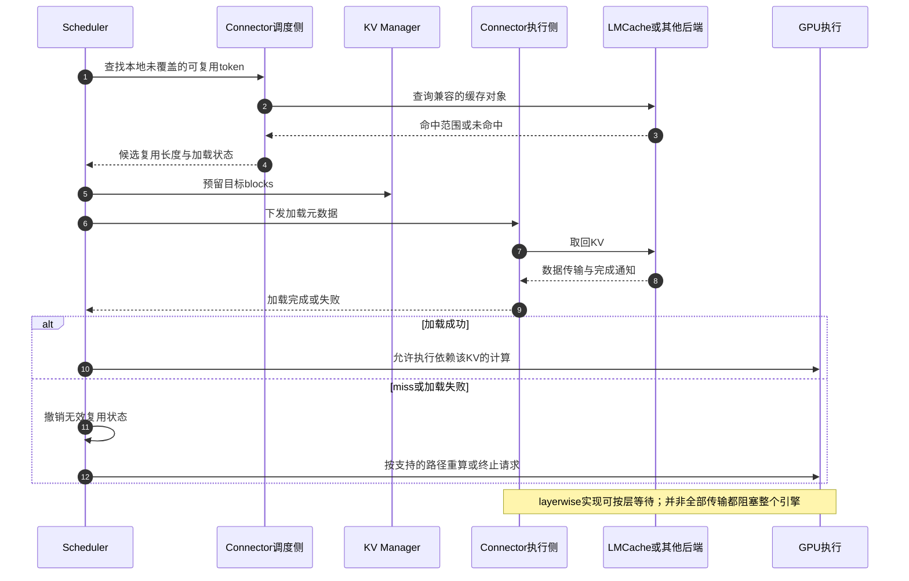
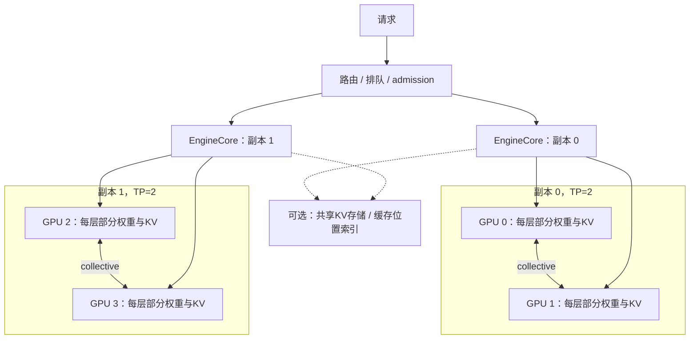
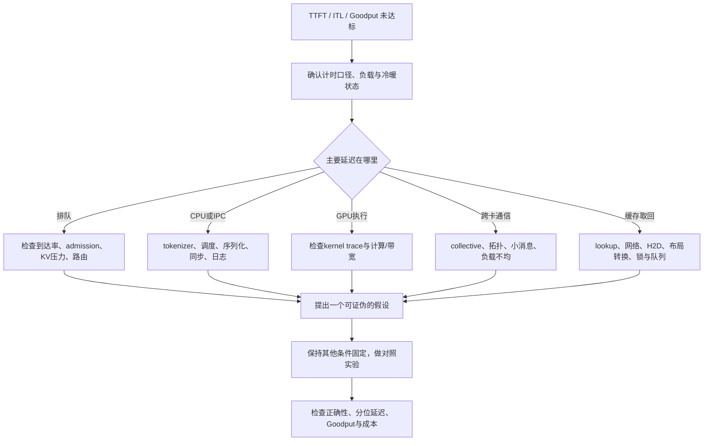

# 知识地图与 vLLM 设计图

[返回导航](README.md) · [KV 专题](04-kv-cache-vllm-lmcache-mooncake.md) · [官方资料](06-references.md)

本章的图以 V1 为主线，表达职责、数据依赖和资源生命周期。进程数、调用位置、同步方式会随版本、executor、并行方案和异步调度配置变化。启动图和状态机是教学抽象，不是逐行调用图。

配套正文见 [07 推理基础](07-inference-foundations.md)、[08 当前源码精读](08-vllm-source-walkthrough.md)、[09 性能与分布式](09-performance-distributed-serving.md)。08 将本章的架构概念落实到当前本地函数，并解释 V1 引擎中的 Model Runner V2。

## 1. 总知识地图

### D01：学习依赖图



### 知识点与掌握深度

| 领域 | 核心知识点 | 必须能解释的联系 |
| --- | --- | --- |
| 模型 | Q/K/V、causal mask、FFN、RoPE、MHA/MQA/GQA | 模型结构如何决定 KV 容量与读取量 |
| 生成 | Prefill、Decode、采样、EOS、长度上限、停止串 | 模型 forward、采样和输出处理为什么是不同步骤 |
| 内存 | 权重、KV、激活、workspace、graph、碎片 | “模型能加载”与“并发可达标”为什么不同 |
| 调度 | 请求队列、token budget、连续批处理、抢占、公平性 | token 数、请求数和显存是不同约束 |
| KV | block table、引用、hash、复用、驱逐、预取 | 逻辑序列如何映射到物理内存 |
| 算子 | GEMM、Attention、归一化、融合、布局 | 带宽、计算和 launch 开销如何变化 |
| Runtime | stream/event、异步执行、CUDA Graph、编译 | 为什么异步提交不等于操作完成 |
| 并行 | TP/PP/DP/EP、长上下文并行、collective、NUMA、拓扑 | 通信成本为何会抵消加卡收益 |
| 缓存系统 | L1/L2、对象状态、租约、chunk、缓存感知路由 | 命中为何仍可能慢、为何不能随时驱逐 |
| 高级模型 | MoE、MLA、SWA、混合 Mamba、多模态、LoRA | 普通全注意力的容量公式与复用规则何时失效 |
| 服务 | streaming、取消、背压、限流、超时、重试、弹性 | 单请求优化为何不一定改善服务 Goodput |
| 验证 | 正确性、质量、负载分布、冷暖缓存、分位数、trace | 性能结论需要哪些证据与适用前提 |

## 2. V1 组件与进程架构

### D02：在线服务的组件图



关键职责：

- **API/Engine Client**：接入、输入处理和输出流。API 并发能力不等于 GPU 的计算容量。
- **EngineCore/Scheduler**：决定谁进入本轮、计算多少 token、需要哪些 blocks。
- **KV Manager**：管理执行引擎的物理 KV blocks；外部缓存不自动替代它。
- **Executor/Worker/ModelRunner**：把调度决策变成设备上的输入、forward 和输出。
- **Connector**：把“外部存在什么”和“如何把数据搬入/搬出”与调度连接起来。

普通稠密模型可把 DP 理解为处理不同请求的副本；MoE 的 DP/EP 组合可能跨 rank 同步，不能一概视作完全独立。离线 `LLM` 接口不必经过 HTTP 路径。依据：V1、V6、V10。

## 3. 启动过程

### D03：服务就绪前的概念流程



不同版本可能交错执行 profiling、编译、KV 初始化和 warmup。学习时关注它们的依赖，而不是背诵一个固定顺序。

容量关系：

```text
设备可用显存预算
  >= 模型权重 + KV + 激活峰值 + workspace + graph/通信缓冲 + 其他开销
```

`gpu_memory_utilization` 是引擎规划显存的参数，不是 GPU 算力利用率，也不能替代对峰值开销的测量。

## 4. 请求运行过程

### D04：普通生成请求时序



完整 Prefill 通常产生可采样首 token 的 logits。后续 Decode 用已经生成的 token 继续 forward。被切分的中间 Prefill 片段不一定产生用户可见输出。

全前缀命中也不应理解为“完全不执行模型”：某些路径需要重新处理尾部 token 以得到下一 token 的 logits；复用粒度和实现会影响剩余计算。

### D05：请求状态机



这是概念状态机，名称不等同于源码 enum。请求逻辑结束、GPU 操作结束和缓存可回收可能发生在不同时间。

## 5. 一轮调度怎么理解

V1 的核心抽象可理解为“为请求分配本轮要计算的 token 数”，不必把 Prefill 和 Decode 维护成两个完全不同的执行系统。概念上，调度器让 `num_computed_tokens` 追赶当前需要计算的 token；投机 token 等特性会扩展这个目标。依据：V2。

假设每轮 token budget 为 8；A、B 各有一个 Decode token 待处理，C 有 10 个 Prefill token 待处理。忽略其他约束：

| 轮次 | A | B | C | 合计 |
| --- | --- | --- | --- | --- |
| 1 | Decode 1 | Decode 1 | Prefill 6 | 8 |
| 2 | Decode 1 | Decode 1 | 剩余 Prefill 4 | 6 |
| 3 | 若未结束则 Decode 1 | 若未结束则 Decode 1 | 若已采样则 Decode 1 | 至多 3 |

实际调度还受请求上限、KV 容量、优先级、外部 KV 就绪、encoder budget、抢占、异步执行和模型限制影响。因此“剩余 token budget”不代表一定能塞进更多请求。

| 约束 | 回答的问题 |
| --- | --- |
| token budget，常见配置如 `max_num_batched_tokens` | 本轮最多处理多少 token？ |
| `max_num_seqs` 等请求数约束 | 本轮最多容纳多少条序列？ |
| `max_model_len` | 单条序列的允许长度是多少？ |
| KV block 容量 | 当前及增长后的缓存是否放得下？ |
| 服务 admission/queue 限制 | 能否继续接受新请求？ |

新版本可能进一步拆分 scheduled/active/queued 等预算，以所选版本为准。不能把 token budget 当成静态 batch size。

## 6. 分页与共享

### D06：逻辑 block 到物理 block 的映射



物理编号不需要连续；共享的完整前缀块只存一份。分页解决分配与共享效率，不能把存储 KV 的逻辑字节数凭空消除。尾块仍可能有内部碎片；共享可变尾块需要额外的隔离或 copy-on-write 机制，不能无条件覆盖。

## 7. 外部缓存如何加入运行链路

### D07：外部命中与加载的时序



调度侧回答“哪些 token 可以复用、目标 blocks 在哪里”，执行侧完成实际搬运和同步。**lookup 命中不是 GPU 数据 ready**。异步加载时，其他请求可能继续运行。准确接口见 V6。

## 8. 多卡部署

### D08：两个稠密模型副本，每副本 TP=2 的示意



- **TP**：同一层切分；减少单卡负担，引入每层通信。
- **PP**：按层/阶段切分；有跨阶段传输和流水气泡。
- **DP**：稠密模型通常复制权重，处理不同请求；提高总服务能力。
- **EP**：MoE 专家分散；需要 token dispatch/combine，可能出现负载不均。
- **上下文并行**：按 token/context 维度分摊 Attention 工作或 KV 状态，面向长上下文；Prefill/Decode 的切分与通信方式可能不同，具体 CP/DCP 等能力需核对版本和后端。

图中的路由、共享缓存和位置索引是可组合的服务组件，不意味着 vLLM 默认部署自动具备完整的缓存感知集群路由。

## 9. 指标与瓶颈地图

| 指标 | 定义与边界 |
| --- | --- |
| TTFT | 从选定起点到首输出的时间；客户端口径包含网络、排队等 |
| ITL | 相邻输出 token 的间隔；流式 chunk 可能包含多个 token，需注明观测方式 |
| TPOT | 对输出数 N>1 的请求，通常取首输出之后的平均每 token 时间 |
| E2E | 请求开始到结束；结束消息和客户端解析可能形成额外尾部开销 |
| tokens/s | 指明输入、输出还是总 token；不能与 requests/s 混用 |
| Goodput | 单位时间内成功且满足指定延迟约束的请求数 |
| 命中率 | 明确按请求、token、chunk 还是字节；明确本地/外部查询的分母 |
| GPU utilization | 活跃程度的一个信号，不等于有效 FLOPs、HBM 利用或业务效率 |

若 TPOT 由首 token 到末 token 的间隔计算，则：

```text
首到末输出耗时 = (N - 1) × TPOT
请求 E2E ≈ TTFT + (N - 1) × TPOT
```

第二式近似忽略首末输出之外的尾部开销。单 token 请求不适用上述 TPOT 公式。Goodput 必须同时报告失败率、拒绝率和提交负载，避免只展示“幸存请求”。

### D09：性能排查决策图



先区分排队、计算和搬运，再调参。指标给出症状，trace 和受控实验才能支持原因判断。
